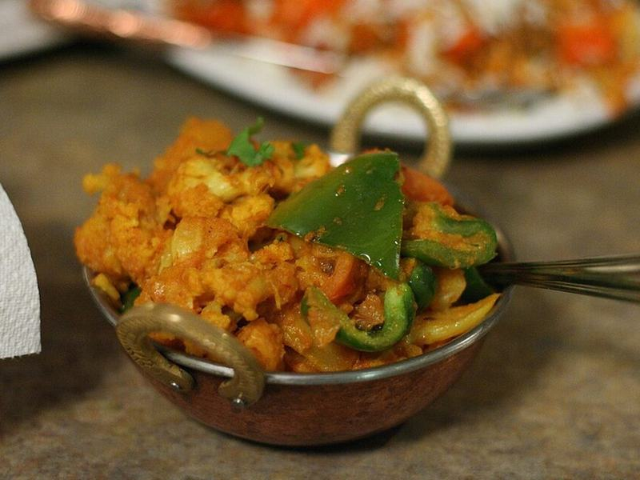

# Aloo Gobi with Basmati Rice

Photo: Geoff Peters from Vancouver, BC, Canada · CC BY 2.0 · [source](https://commons.wikimedia.org/wiki/File:Aloo_gobi_(cauliflower_and_potato)_(3170159574).jpg)

**Dinner** · Indian · 45 min · serves 4 · skill 1/3

> Potatoes and cauliflower browned in a skillet with cumin, turmeric, ginger and tomato until tender and golden at the edges. It's a dry-style Punjabi curry, good with rice or warm roti.

| Per serving | kcal | Protein | Carbs | Fat | Fiber | Sodium | Cost |
| --- | --- | --- | --- | --- | --- | --- | --- |
| | 605 | 14 g | 107 g | 16 g | 11 g | 390 mg | $1.75 |

Contains: none of the tracked allergens

## Ingredients

- 1 head cauliflower, in small florets
- 1½ lb russet potatoes (2 large), in ¾-inch cubes
- 1 onion, finely chopped
- 2 Roma tomatoes, chopped
- 1 tbsp grated ginger
- 4 garlic cloves, minced
- 1 jalapeño or green chili, minced
- 1 tsp garam masala
- ½ bunch cilantro, chopped
- ½ lemon
- 1½ cups basmati rice

From the pantry: 4 tbsp oil, 1 tsp cumin seeds, 1 tsp turmeric, 2 tsp ground coriander, 1 tsp Kashmiri chili powder or paprika, salt

## Steps

1. Start the rice. Heat 3 tbsp oil in a large skillet with a lid over medium-high. Add the potatoes in one layer and cook, turning now and then, until golden on a few sides, 6 to 7 minutes.
2. Add the cauliflower and the remaining oil and cook, stirring occasionally, until the florets have golden spots, 5 minutes. Push everything to the edges.
3. Add the cumin seeds to the center and let them sizzle 20 seconds, then add the onion and cook 3 minutes. Stir in the ginger, garlic, chili, turmeric, coriander, chili powder and 1¼ tsp salt for 1 minute.
4. Add the tomatoes and 3 tbsp water and stir to coat everything. Cover, turn to medium-low and cook, stirring gently every 5 minutes, until a knife slides easily into the potatoes, 12 to 15 minutes.
5. Uncover and cook 2 minutes to dry it out. Stir in the garam masala, a squeeze of lemon and the cilantro. Serve with rice or warm roti.

**Tip:** Keep the water to a minimum. Aloo gobi should be dry and spiced, not saucy, so the potatoes stay whole.

## Storing

Fridge 4 days · freezer up to 2 months. Reheat in a skillet with a little oil to bring back the browned edges, or microwave 2 minutes.

