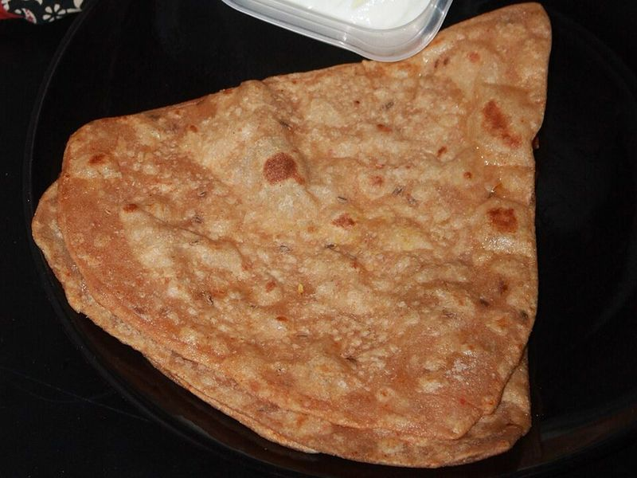

# Aloo Paratha (Spiced Potato-Stuffed Flatbreads) with Yogurt

Photo: Nithyasrm · CC BY-SA 4.0 · [source](https://commons.wikimedia.org/wiki/File:Triangle_paratha_(cropped).JPG)

**Breakfast** · North Indian · 60 min · serves 4 · skill 2/3

> Punjab's favorite breakfast: soft flatbreads stuffed with cumin-and-chili-spiked mashed potato, griddled in butter until blistered and crisp, served with cool yogurt.

| Per serving | kcal | Protein | Carbs | Fat | Fiber | Sodium | Cost |
| --- | --- | --- | --- | --- | --- | --- | --- |
| | 390 | 13 g | 58 g | 12 g | 5 g | 390 mg | $0.80 |

Contains: gluten, dairy, spicy

## Ingredients

- 1½ lb russet potatoes (about 3)
- ¼ cup chopped cilantro
- 4 green onions, finely chopped
- 1 tsp grated ginger
- 1 green chili, minced
- 3 tbsp butter or ghee, melted
- 1 cup plain yogurt, to serve

From the pantry: 2½ cups flour, 1½ tsp salt, 1 tbsp oil, 1 tsp garam masala, 1 tsp ajwain (carom seeds) or dried thyme, ½ tsp ground cumin, ½ tsp chili powder, ½ tsp amchur (dried mango powder) or 1 tsp lemon juice

## Steps

1. Mix the flour, 1 tsp salt, the oil and about 1 cup water into a dough, then knead until smooth and elastic, about 5 minutes. Cover and rest at least 20 minutes.
2. Meanwhile boil the peeled, quartered potatoes in salted water until very tender, 15 minutes. Drain well, let them steam dry, then mash until completely smooth. Mix in the cilantro, green onions, ginger, chili, all the spices and ½ tsp salt.
3. Divide the dough and filling into 8 pieces each. Roll a dough ball into a 4-inch circle, set a ball of filling in the center, gather the edges over it and pinch to seal. Flatten, dust with flour and roll gently, seam side down, into a 7-inch round.
4. Heat a cast-iron skillet or griddle over medium. Cook a paratha until light spots appear underneath, about 1 minute, flip, brush with butter, and flip again. Keep cooking and pressing the edges with a spatula until both sides are golden and crisp, 2 to 3 minutes total.
5. Keep the cooked parathas warm in a low oven under a towel while you cook the rest. Serve hot with yogurt and a little pickle if you like.

**Tip:** Mash the potatoes with no lumps and let them cool before stuffing. Lumps tear the dough and steam makes it soggy. Whole wheat atta from an Indian grocery gives the traditional nutty flavor.

Adapted from [RecipeTin Eats](https://www.recipetineats.com/aloo-paratha-indian-potato-stuffed-flatbread/).

## Storing

Fridge 3 days · freezer up to 2 months. Freeze cooked parathas between parchment and reheat straight from frozen in a dry skillet, 2 minutes per side.

