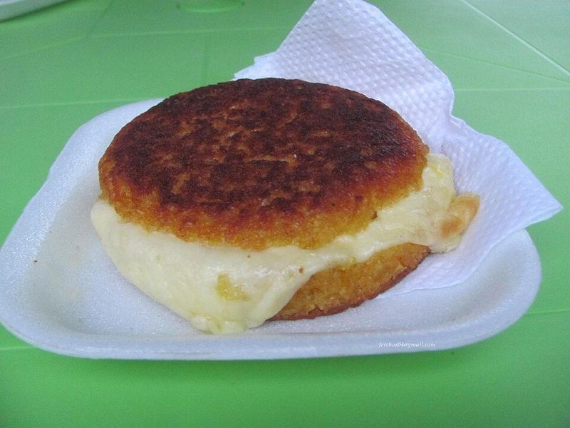

# Venezuelan Arepas with Perico Eggs & Cheese

Photo: Nelson Fernando Sotelo Castro · CC BY 2.0 · [source](https://commons.wikimedia.org/wiki/File:Arepa_de_chocolo.jpg)

**Breakfast** · Venezuelan · 40 min · serves 4 · skill 2/3

> Crisp-shelled, fluffy corn cakes split open and stuffed with perico, Venezuela's soft eggs with tomato and green onion, plus melty cheese and avocado.

| Per serving | kcal | Protein | Carbs | Fat | Fiber | Sodium | Cost |
| --- | --- | --- | --- | --- | --- | --- | --- |
| | 655 | 23 g | 60 g | 38 g | 9 g | 630 mg | $1.47 |

Contains: egg, dairy

## Ingredients

- 2 cups masarepa (precooked white corn flour)
- 6 eggs
- 2 Roma tomatoes, diced
- 4 green onions, sliced
- 1 cup shredded mozzarella
- 2 avocados, sliced
- 2 tbsp butter

From the pantry: 2 tbsp oil, 1 tsp salt

## Steps

1. Heat the oven to 375°F. Stir the masarepa and 1 tsp salt in a bowl, then add 2½ cups warm water and mix with your hand. Let rest 5 minutes, then knead into a soft dough that doesn't crack at the edges; add water a tablespoon at a time if it does.
2. Divide into 8 balls and flatten each into a ½-inch-thick disk, smoothing any cracks with a wet finger.
3. Heat the oil in a large skillet over medium. Cook the arepas until a golden crust forms, 5 to 6 minutes per side, then move to a baking sheet and bake 15 minutes, until they sound hollow when tapped.
4. Meanwhile melt the butter in a nonstick skillet over medium. Cook the tomato and green onion until soft, 3 minutes. Add the beaten eggs with a pinch of salt and stir gently until softly set, 2 minutes.
5. Split each hot arepa with a knife like a pita, stuff with cheese first so it melts, then the eggs and avocado.

**Tip:** Masarepa is not masa harina or cornmeal; look for P.A.N. or Goya masarepa in the Latin aisle. Other corn flours won't hold together.

## Storing

Fridge 3 days · freezer up to 2 months. Freeze cooked, unfilled arepas. Reheat in a 375°F oven or toaster oven for 10 to 12 minutes until crisp.

