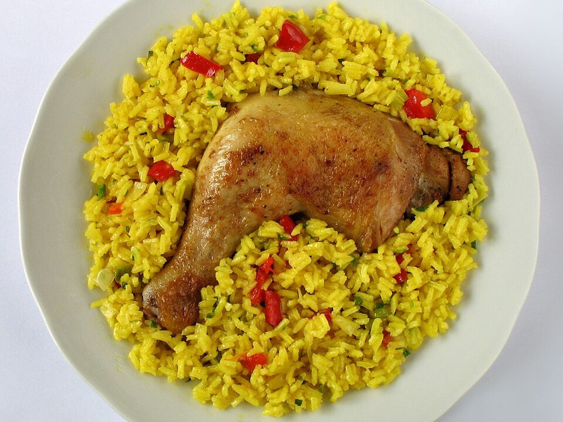

# Arroz con Pollo

Photo: Kobako · CC BY-SA 2.5 · [source](https://commons.wikimedia.org/wiki/File:Arroz-con-Pollo.jpg)

**Dinner** · Puerto Rican & Dominican · 55 min · serves 6 · skill 1/3

> Latin one-pot comfort: seared chicken and saffron-yellow rice simmered with sofrito, peppers, peas and olives.

| Per serving | kcal | Protein | Carbs | Fat | Fiber | Sodium | Cost |
| --- | --- | --- | --- | --- | --- | --- | --- |
| | 495 | 37 g | 57 g | 13 g | 5 g | 930 mg | $2.60 |

Contains: none of the tracked allergens

## Ingredients

- 2 lb chicken thighs
- 1 onion
- 2 bell peppers
- 4 garlic cloves
- 1 cup tomato sauce or crushed tomatoes
- 2 cups long-grain rice
- 3 cups broth
- 1 cup peas
- green olives
- cilantro

From the pantry: 2 tbsp olive oil, 1 tsp cumin, 1 tsp oregano, 1 tsp turmeric (or a sazón packet), salt, pepper

## Steps

1. Season the chicken and brown in the oil in a Dutch oven, 5 minutes per side. Remove.
2. Cook the onion, peppers and garlic (your sofrito) until soft, 6 minutes. Add the spices and tomato sauce for 2 minutes.
3. Stir in the rice to coat, then add the broth and 1 tsp salt.
4. Nestle the chicken back in, cover and simmer on low 25 minutes until the rice is tender.
5. Scatter over the peas and olives, cover 5 minutes more, then finish with cilantro.

**Tip:** Don't stir the rice while it simmers. A little crispy bottom (pegao) is a prize.

## Storing

Fridge 4 days · freezer up to 3 months. Microwave with a splash of broth, covered.

## Other ways to make it

- Steak
- Shrimp
- Pork
- Tofu
