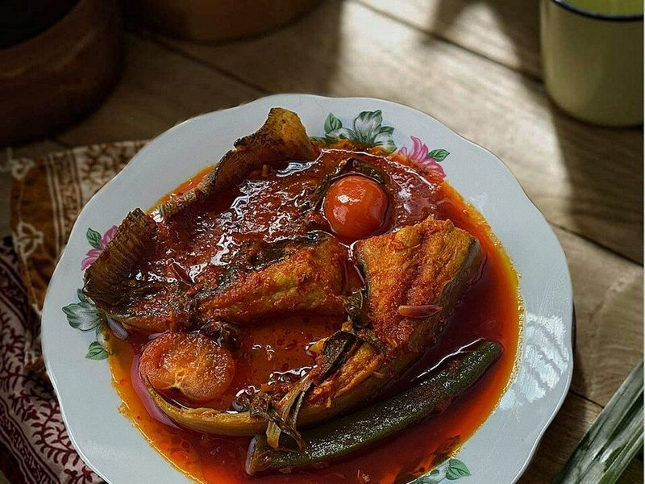

# Asam Pedas (Sour & Spicy Tamarind Fish Stew)

Photo: Elly Suhailee · CC BY-SA 4.0 · [source](https://commons.wikimedia.org/wiki/File:ASAM_PEDAS_IKAN_PARI.jpg)

**Dinner** · Malaysian & Singaporean · 40 min · serves 4 · skill 2/3

> A Malay home-cooking favorite: firm fish gently poached in a tangy, fiery red tamarind gravy with okra, tomatoes and eggplant. It's sour, hot and a little sweet, and begs for rice.

| Per serving | kcal | Protein | Carbs | Fat | Fiber | Sodium | Cost |
| --- | --- | --- | --- | --- | --- | --- | --- |
| | 700 | 41 g | 99 g | 16 g | 7 g | 660 mg | $3.74 |

Contains: fish, spicy

## Ingredients

- 1½ lb firm white fish fillets (tilapia or cod), in large pieces
- 3 tbsp tamarind concentrate
- 1 onion, chopped
- 2 garlic cloves
- 1 tbsp lemongrass paste
- 1 tsp grated ginger
- 1 tbsp fish sauce
- 8 oz frozen okra
- 2 Roma tomatoes, in wedges
- ½ eggplant, in chunks
- a handful of mint leaves
- 2 cups jasmine rice

From the pantry: 10 dried red chiles, ¼ cup oil, 1 tbsp sugar, 1 tsp curry powder, salt

## Steps

1. Start the rice. Soak the chiles in boiling water for 10 minutes, then stem, seed and blend with the onion, garlic, lemongrass, ginger and a splash of water into a smooth paste.
2. Heat the oil in a wide pot over medium and fry the paste with the curry powder, stirring, until it turns deep red and the oil separates, 6 to 8 minutes.
3. Add 1½ cups water, the tamarind, fish sauce and sugar and bring to a boil. Add the eggplant and simmer 5 minutes, then the okra and tomatoes for 3 minutes.
4. Season the fish with salt, slide it into the gravy and spoon some over the top. Simmer gently, without stirring, until it flakes, 5 to 6 minutes.
5. Taste and balance with more tamarind, sugar or salt, scatter with torn mint and serve with rice.

**Tip:** Spanish mackerel (tenggiri) or stingray is traditional, and daun kesum (Vietnamese coriander) gives the signature aroma; mint plus a few cilantro leaves comes close. A teaspoon of belacan in the paste adds depth.

Adapted from [Rasa Malaysia](https://rasamalaysia.com/recipe-assam-pedas-fish/).

## Storing

Fridge 2 days · freezer not recommended. Reheat gently in a covered pan over low heat until just hot so the fish doesn't break up.

