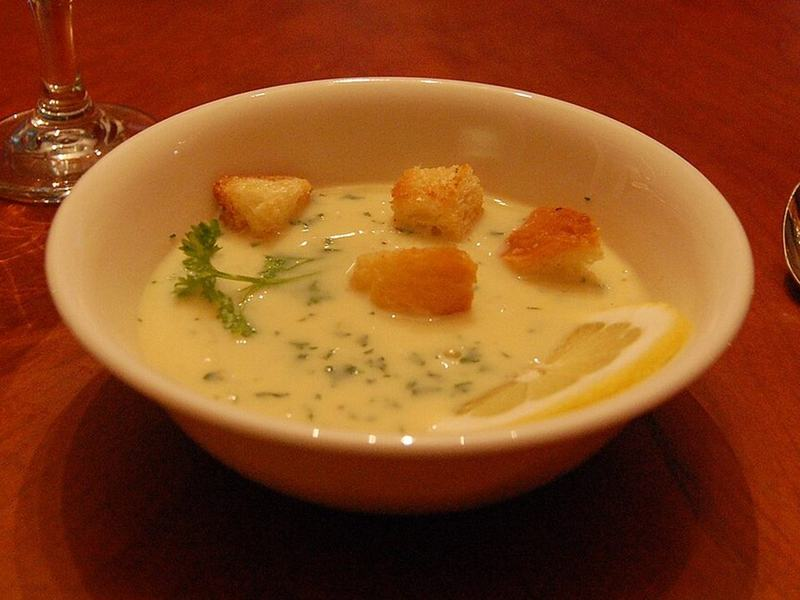

# Avgolemono (Greek Lemon Chicken & Rice Soup)

Photo: robin.norwood · CC BY-SA 2.0 · [source](https://commons.wikimedia.org/wiki/File:Avgolemono_soup.jpg)

**Lunch** · Greek & Mediterranean · 45 min · serves 6 · skill 2/3

> Tender chicken and rice in a broth made silky and tangy with whisked eggs and lots of lemon. It's creamy without any cream.

| Per serving | kcal | Protein | Carbs | Fat | Fiber | Sodium | Cost |
| --- | --- | --- | --- | --- | --- | --- | --- |
| | 500 | 40 g | 56 g | 12 g | 3 g | 1860 mg | $2.43 |

Contains: egg, gluten

## Ingredients

- 1½ lb boneless chicken breasts
- 10 cups chicken broth
- 1 cup long-grain rice
- 4 eggs
- 3 lemons, juiced (about ½ cup)
- 1 onion, finely chopped
- 2 carrots, diced
- 2 celery stalks, diced
- ½ bunch parsley or dill, chopped
- 1 baguette, warmed, for serving

From the pantry: 2 tbsp olive oil, 1 tsp salt, ½ tsp pepper, 1 bay leaf

## Steps

1. Heat the oil in a large pot over medium heat and cook the onion, carrots and celery until soft, 6 to 8 minutes.
2. Add the broth, bay leaf and whole chicken breasts and bring to a simmer. Cook gently until the chicken is 165°F inside, 15 to 18 minutes. Lift out the chicken and shred it.
3. Add the rice to the simmering broth and cook until tender, 15 minutes. Turn the heat to low and remove the bay leaf.
4. Whisk the eggs and lemon juice in a bowl until frothy. Slowly whisk in 2 cups of hot broth, a ladle at a time, to warm the eggs.
5. Pour the egg mixture back into the pot, stirring constantly, and heat gently without boiling until the soup turns silky, 2 to 3 minutes. Stir in the chicken, season with salt and pepper, and finish with parsley. Serve with warm bread for dipping.

**Tip:** Never let the soup boil once the eggs are in, or they'll scramble. Steaming and barely trembling is perfect.

## Storing

Fridge 4 days · freezer not recommended. The egg can curdle in the freezer. Reheat gently over medium-low, stirring, until hot but not boiling; add a splash of broth if the rice has soaked up the liquid.

## Other ways to make it

- Steak
- Shrimp
- Pork
- Tofu
