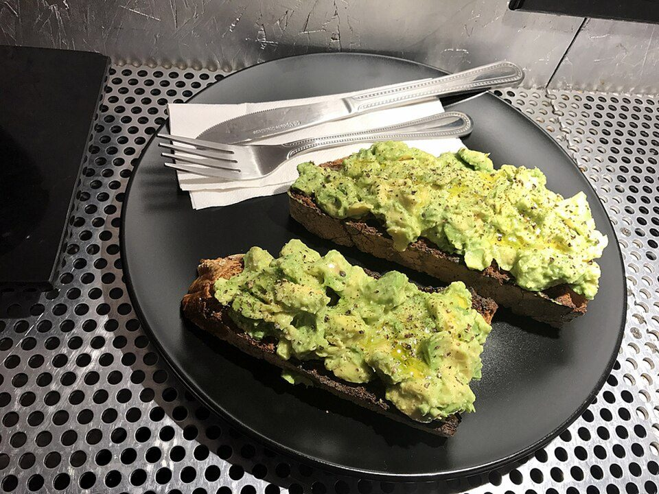

# Jammy Egg Avocado Toast with Chili Crisp

Photo: Bex Walton from London, England · CC BY 2.0 · [source](https://commons.wikimedia.org/wiki/File:Avocado_toast_at_Voyager_Espresso_(33134505776).jpg)

**Breakfast** · American comfort · 15 min · serves 2 · skill 1/3

> Thick sourdough toast, lemony smashed avocado, 7-minute jammy eggs and a spoonful of crunchy chili crisp.

| Per serving | kcal | Protein | Carbs | Fat | Fiber | Sodium | Cost |
| --- | --- | --- | --- | --- | --- | --- | --- |
| | 690 | 26 g | 61 g | 40 g | 13 g | 1790 mg | $2.29 |

Contains: egg, gluten, sesame, spicy

## Ingredients

- 4 thick slices sourdough
- 2 ripe avocados
- 4 eggs
- ½ lemon
- 2 tbsp chili crisp
- everything bagel seasoning
- a handful of spring mix

From the pantry: Flaky salt, olive oil

## Steps

1. Bring a small pot of water to a boil. Lower in the eggs and cook exactly 7 minutes, then move them to ice water.
2. Toast the sourdough until deep golden and brush with olive oil.
3. Mash the avocados with the lemon juice and a big pinch of salt.
4. Peel and halve the eggs.
5. Spread the avocado on the toast, add greens and egg halves, then spoon on the chili crisp and sprinkle with everything seasoning.

**Tip:** Ice-water-shocked eggs peel far more easily. Give them at least 2 minutes.

## Storing

Fridge 0 days · freezer not recommended. Best made fresh. Jammy eggs keep 3 days peeled in a sealed container.

