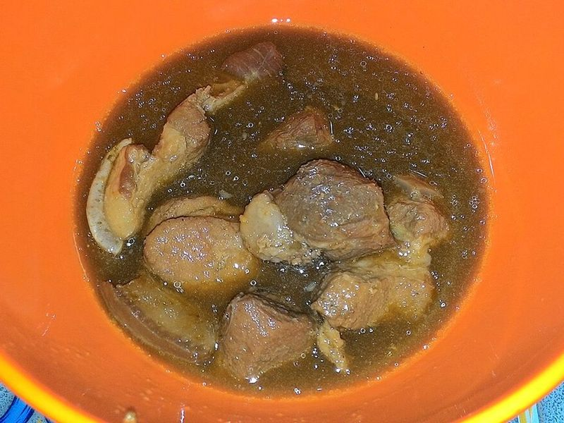

# Babi Kecap (Sweet Soy Braised Pork)

Photo: Gunawan Kartapranata · CC BY-SA 4.0 · [source](https://commons.wikimedia.org/wiki/File:Babi_kecap_1.jpg)

**Dinner** · Indonesian · 110 min · serves 5 · skill 2/3

> A Chinese-Indonesian classic: chunks of pork shoulder slowly braised with ginger, garlic and onions in kecap manis until spoon-tender and coated in a dark, sticky, sweet-salty glaze. Finished with lime and served with rice and sambal.

| Per serving | kcal | Protein | Carbs | Fat | Fiber | Sodium | Cost |
| --- | --- | --- | --- | --- | --- | --- | --- |
| | 805 | 38 g | 73 g | 40 g | 4 g | 1460 mg | $2.27 |

Contains: gluten, pork, spicy

## Ingredients

- 2 lb boneless pork shoulder, in 1½-inch chunks
- 6 tbsp kecap manis
- 2 tbsp soy sauce
- 1-inch piece ginger, grated
- 6 garlic cloves, grated
- 2 onions, thinly sliced
- 1 tbsp sambal oelek, to serve
- 1 lime
- 8 oz green beans, for the side
- 1½ cups jasmine rice

From the pantry: 2 tbsp oil, 1 tbsp brown sugar, 1 tsp black pepper, salt

## Steps

1. Toss the pork with the ginger, garlic and pepper. Heat the oil in a Dutch oven over medium-high and brown the pork in two batches, 5 to 6 minutes per batch. Set aside.
2. Lower the heat to medium, add the onions with a pinch of salt and cook until soft and golden, 6 to 8 minutes.
3. Return the pork with the kecap manis, soy sauce, brown sugar and 1 cup water. Bring to a simmer, cover and braise on low until the pork is very tender, about 1 hour 15 minutes. Start the rice in the last 20 minutes.
4. Uncover, skim off excess fat, then raise the heat to medium and simmer, stirring, until the sauce reduces to a thick glaze, 8 to 10 minutes. Squeeze in the juice of half the lime.
5. Steam or blanch the green beans for 3 to 4 minutes. Serve the pork over rice with the beans, the sambal and lime wedges.

**Tip:** Pork belly is the traditional cut if you want it richer. No kecap manis? Simmer equal parts soy sauce and brown sugar with a spoon of molasses until syrupy.

Adapted from [Milk Street](https://www.177milkstreet.com/recipes/sweet-soy-braised-pork-babi-kecap).

## Storing

Fridge 5 days · freezer up to 3 months. Reheat covered on the stove over low with a splash of water, or microwave 2 minutes.

