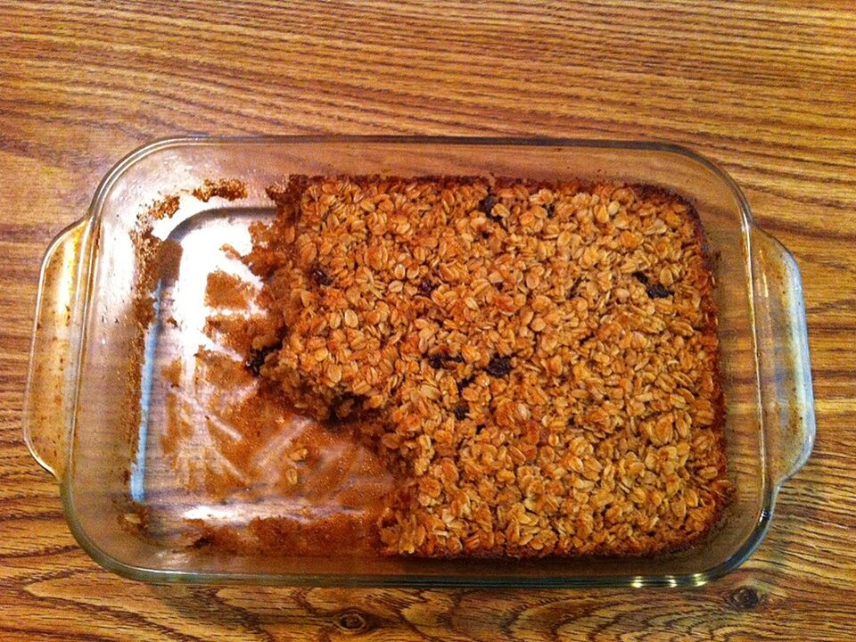

# Banana Bread Baked Oatmeal

Photo: Pete unseth · CC BY-SA 3.0 · [source](https://commons.wikimedia.org/wiki/File:Baked_oatmeal.JPG)

**Breakfast** · American comfort · 40 min · serves 6 · skill 1/3

> Tastes like banana bread, eats like breakfast: a sliceable pan of cinnamon oats baked with ripe bananas and melty chocolate chips.

| Per serving | kcal | Protein | Carbs | Fat | Fiber | Sodium | Cost |
| --- | --- | --- | --- | --- | --- | --- | --- |
| | 330 | 9 g | 49 g | 12 g | 5 g | 280 mg | $0.51 |

Contains: dairy, egg, gluten

## Ingredients

- 2 cups rolled oats
- 3 ripe bananas
- 2 eggs
- 1½ cups milk
- 3 tbsp honey or maple syrup
- ⅓ cup chocolate chips
- 2 tbsp melted butter

From the pantry: 1 tsp baking powder, 1½ tsp cinnamon, 1 tsp vanilla, ½ tsp salt

## Steps

1. Heat the oven to 375°F and butter an 8x8 pan.
2. Mash 2 bananas and whisk with the eggs, milk, honey, butter and vanilla.
3. Stir in the oats, baking powder, cinnamon, salt and most of the chocolate chips.
4. Pour into the pan, top with the last banana sliced and the remaining chips.
5. Bake 30 to 35 minutes until set and golden. Cut into squares. Keeps 5 days refrigerated.

**Tip:** Warm a square with a splash of milk and a spoon of Greek yogurt.

## Storing

Fridge 5 days · freezer up to 3 months. Store squares in a container. Microwave 45 seconds with a splash of milk.

