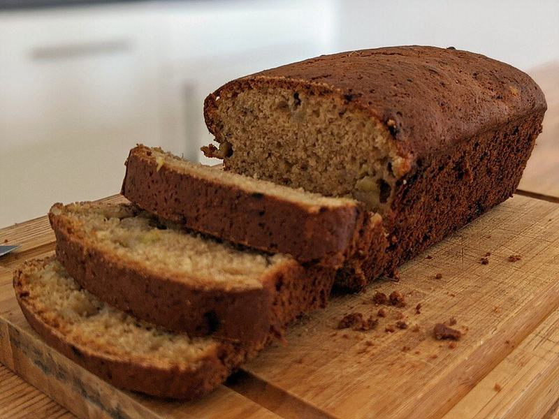

# Brown Sugar Banana Bread

Photo: Shisma · CC BY 4.0 · [source](https://commons.wikimedia.org/wiki/File:Banana_bread_slices.jpg)

**Breakfast** · American comfort · 75 min · serves 8 · skill 1/3

> A moist, deeply caramelized loaf made with very ripe bananas, brown sugar, butter and a touch of cinnamon, with a crackly domed top.

| Per serving | kcal | Protein | Carbs | Fat | Fiber | Sodium | Cost |
| --- | --- | --- | --- | --- | --- | --- | --- |
| | 335 | 6 g | 49 g | 13 g | 2 g | 260 mg | $0.32 |

Contains: gluten, egg, dairy

## Ingredients

- 3 very ripe bananas
- 1¾ cups all-purpose flour
- 2 eggs
- ½ cup (1 stick) butter, melted
- ¼ cup plain Greek yogurt

From the pantry: ⅔ cup brown sugar, 1 tsp baking soda, 1 tsp vanilla, 1 tsp cinnamon, ½ tsp salt

## Steps

1. Heat the oven to 350°F and grease and line a 9x5 loaf pan with parchment.
2. Mash the bananas in a large bowl until mostly smooth. Whisk in the melted butter, brown sugar, eggs, yogurt and vanilla.
3. Sprinkle the baking soda, cinnamon and salt over the batter and whisk in, then fold in the flour with a spatula until no dry streaks remain.
4. Scrape into the pan and bake 55 to 65 minutes, until deep golden and a toothpick in the center comes out with just a few moist crumbs. Tent with foil if the top darkens before the middle is done.
5. Cool in the pan 15 minutes, then lift out and cool on a rack before slicing.

**Tip:** Use bananas that are more brown than yellow. The riper they are, the sweeter and more moist the bread.

## Storing

Fridge 4 days · freezer up to 3 months. Wrap tightly; keeps 2 days at room temperature or 4 chilled. Freeze slices and toast from frozen.

