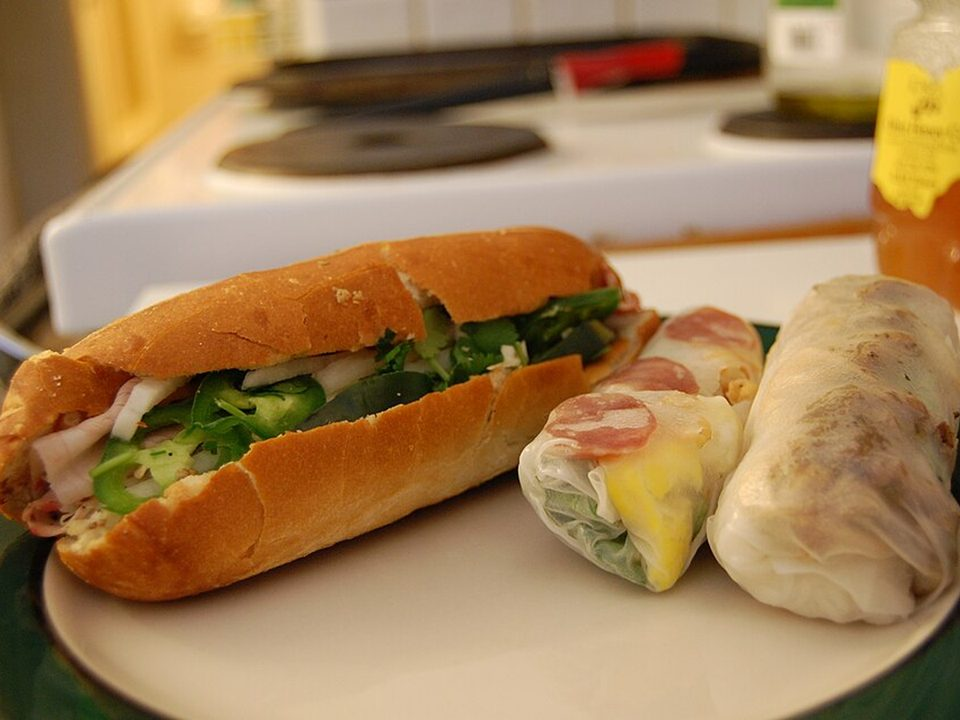

# Caramelized Chicken Bánh Mì

Photo: stu_spivack · CC BY-SA 2.0 · [source](https://commons.wikimedia.org/wiki/File:Banh_mi_and_cuon.jpg)

**Lunch** · Vietnamese · 30 min · serves 4 · skill 1/3

> Sticky lemongrass-style chicken in a crackly baguette with quick-pickled carrots and cucumber, jalapeño, cilantro and sriracha mayo.

| Per serving | kcal | Protein | Carbs | Fat | Fiber | Sodium | Cost |
| --- | --- | --- | --- | --- | --- | --- | --- |
| | 760 | 39 g | 98 g | 24 g | 5 g | 1880 mg | $2.36 |

Contains: gluten, egg, spicy

## Ingredients

- 1 lb boneless thighs, thinly sliced
- 2 tbsp soy sauce
- 2 tbsp honey
- 3 garlic cloves
- 2 baguettes, each cut in 2
- 2 carrots, in matchsticks
- ½ cucumber, in spears
- 1 jalapeño, sliced
- 1 bunch cilantro

From the pantry: ½ cup rice vinegar, 2 tbsp sugar, ⅓ cup mayo, 1 tbsp sriracha, 1 tbsp oil, salt

## Steps

1. Quick-pickle the carrots in the vinegar, sugar and ½ tsp salt for at least 15 minutes.
2. Toss the chicken with the soy, honey and garlic.
3. Sear in the oil over high heat until caramelized and cooked, 6 minutes.
4. Stir the mayo and sriracha together. Split and toast the baguettes.
5. Spread with sriracha mayo and fill with chicken, drained pickles, cucumber, jalapeño and lots of cilantro.

**Tip:** The pickled carrots keep 2 weeks in the fridge. Make a big jar.

## Storing

Fridge 2 days · freezer not recommended. Store chicken and pickles separately. Build sandwiches fresh on a toasted baguette.

## Other ways to make it

- Steak
- Shrimp
- Pork
- Tofu
