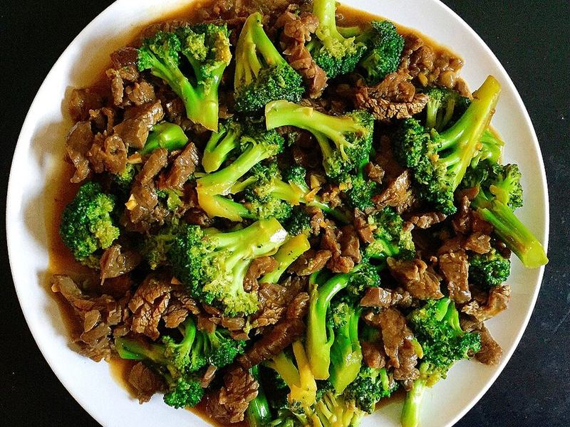

# Beef & Broccoli Stir-Fry

Photo: Joy · CC BY 2.0 · [source](https://commons.wikimedia.org/wiki/File:Beef_and_broccoli_stir_fry.jpg)

**Dinner** · Chinese & Cantonese · 25 min · serves 4 · skill 1/3

> Tender, velveted strips of beef and crisp-tender broccoli in a glossy garlic-ginger-soy sauce. Faster than delivery.

| Per serving | kcal | Protein | Carbs | Fat | Fiber | Sodium | Cost |
| --- | --- | --- | --- | --- | --- | --- | --- |
| | 610 | 40 g | 71 g | 19 g | 5 g | 1150 mg | $3.63 |

Contains: beef, gluten

## Ingredients

- 1¼ lb sirloin or flank steak, very thinly sliced
- 1½ lb broccoli florets
- ⅓ cup soy sauce
- 2 tbsp honey or brown sugar
- 4 garlic cloves, minced
- 1-inch ginger, grated
- ½ cup beef broth
- 1½ cups jasmine rice
- sesame seeds

From the pantry: 2 tbsp cornstarch, ¼ tsp baking soda, 2 tbsp oil, 1 tsp sesame oil

## Steps

1. Toss the beef with 1 tbsp soy, 1 tbsp cornstarch and the baking soda. Rest 15 minutes. This makes it tender. Start the rice.
2. Whisk the remaining soy, honey, broth, sesame oil and 1 tbsp cornstarch.
3. Sear the beef in a very hot pan with 1 tbsp oil in a single layer, 1 minute per side. Remove.
4. Add the remaining oil and the broccoli with 2 tbsp water. Cover and cook 2 minutes. Add the garlic and ginger for 30 seconds.
5. Add the sauce and beef and toss until thick and glossy, 1 minute. Serve over rice with sesame seeds.

**Tip:** Freeze the steak for 20 minutes before slicing to get paper-thin strips.

## Storing

Fridge 4 days · freezer up to 2 months. Reheat in a skillet over medium with a splash of water until hot, 3 to 5 minutes.

## Other ways to make it

- Chicken
- Shrimp
- Pork
- Tofu
