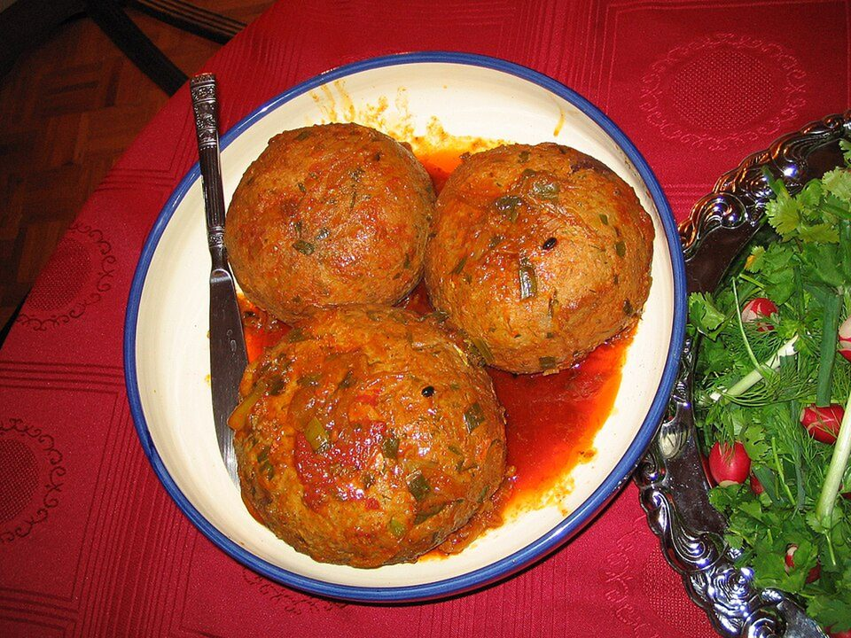

# Beef Kofta with Herbed Rice & Tzatziki

Photo: Fabienkhan · CC BY-SA 2.5 · [source](https://commons.wikimedia.org/wiki/File:Koofteh_tabrizi.jpg)

**Dinner** · Turkish · 35 min · serves 4 · skill 1/3

> Juicy grilled skewers of spiced ground beef and onion with cool tzatziki, warm pita and a bright tomato-cucumber salad.

| Per serving | kcal | Protein | Carbs | Fat | Fiber | Sodium | Cost |
| --- | --- | --- | --- | --- | --- | --- | --- |
| | 945 | 44 g | 98 g | 42 g | 6 g | 1010 mg | $4.48 |

Contains: beef, dairy, gluten

## Ingredients

- 1½ lb ground beef (or half lamb)
- 1 onion, grated
- 1 bunch parsley
- 4 garlic cloves
- 12 oz tzatziki
- 1½ cups rice
- 4 pitas
- 1 pint tomatoes
- 1 cucumber
- 1 lemon

From the pantry: 2 tsp cumin, 2 tsp paprika, 1 tsp coriander, ½ tsp cinnamon, 1½ tsp salt, olive oil

## Steps

1. Squeeze the grated onion dry. Mix with the beef, half the parsley (chopped), garlic, spices and salt. Don't overmix.
2. Shape into 12 long ovals around skewers or into logs.
3. Grill or broil 4 minutes per side until charred and cooked through. Cook the rice and stir in chopped parsley and lemon zest.
4. Toss the tomatoes and cucumber with olive oil, lemon juice and salt.
5. Serve kofta over rice with tzatziki, salad and warm pita.

**Tip:** Chill the shaped kofta 15 minutes so they hold on the skewers.

## Storing

Fridge 4 days · freezer up to 3 months. Reheat kofta in a skillet or microwave. Keep tzatziki cold.

## Other ways to make it

- Ground turkey
- Ground pork
- Italian sausage
- Lentils (veg)
