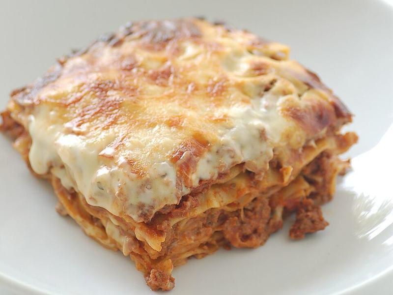

# Classic Beef & Sausage Lasagna

Photo: jules / stonesoup · CC BY 2.0 · [source](https://commons.wikimedia.org/wiki/File:Lasagne_-_stonesoup.jpg)

**Dinner** · Italian · 110 min · serves 8 · skill 2/3

> Tall, sliceable layers of meaty sauce, creamy ricotta and molten mozzarella under a browned, bubbling top. The Sunday dinner that feeds you through Wednesday.

| Per serving | kcal | Protein | Carbs | Fat | Fiber | Sodium | Cost |
| --- | --- | --- | --- | --- | --- | --- | --- |
| | 935 | 51 g | 63 g | 52 g | 6 g | 1970 mg | $3.02 |

Contains: beef, pork, dairy, gluten, egg

## Ingredients

- 1 lb ground beef
- 1 lb Italian sausage, casings removed
- 1 onion, diced
- 4 garlic cloves, minced
- 2 jars (48 oz) marinara
- 1 box lasagna noodles
- 15 oz ricotta
- 1 egg
- 1 cup grated Parmesan, divided
- 4 cups shredded mozzarella
- fresh basil

From the pantry: 1 tbsp olive oil, 1 tsp dried oregano, salt, pepper

## Steps

1. Brown the beef and sausage with the onion in the oil, 10 minutes. Add the garlic and oregano, then the marinara and ½ cup water. Simmer 15 minutes.
2. Boil the noodles 2 minutes short of the package time. Drain and lay flat on oiled foil.
3. Mix the ricotta, egg, ½ cup Parmesan, chopped basil, salt and pepper.
4. In a 9x13, layer: 1 cup sauce, noodles, ⅓ of the ricotta, 1 cup mozzarella, sauce. Repeat twice, then finish with noodles, sauce, the remaining mozzarella and Parmesan.
5. Cover with oiled foil and bake at 375°F for 40 minutes, uncover and bake 15 minutes more until browned. Rest 20 minutes before cutting, or it won't hold its shape.

**Tip:** Freeze half before baking. Bake from frozen, covered, at 375°F for about 90 minutes.

## Storing

Fridge 5 days · freezer up to 3 months. Reheat covered at 350°F for 15 to 20 minutes (or microwave single portions 2 minutes).

## Other ways to make it

- Ground turkey
- Ground pork
- Italian sausage
- Lentils (veg)
