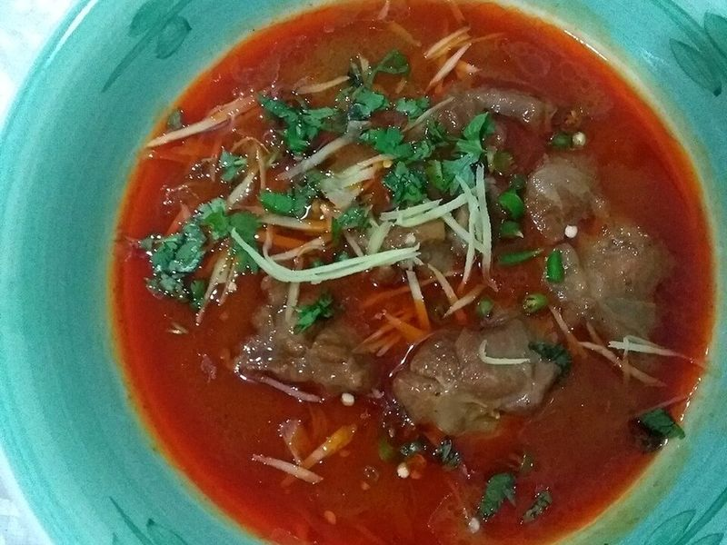

# Beef Nihari (Slow-Simmered Spiced Beef Stew)

Photo: Satcreak · CC BY-SA 4.0 · [source](https://commons.wikimedia.org/wiki/File:Beef_Nihari,_made_by_Saleha_Atif,_Pakistan.jpg)

**Dinner** · Pakistani · 240 min · serves 6 · skill 3/3

> Pakistan's legendary Sunday stew: beef simmered for hours in a fragrant fennel, star anise and ginger masala until it falls apart, thickened into a silky gravy and piled with fried onions, ginger, chilies and lemon.

| Per serving | kcal | Protein | Carbs | Fat | Fiber | Sodium | Cost |
| --- | --- | --- | --- | --- | --- | --- | --- |
| | 750 | 40 g | 57 g | 41 g | 4 g | 770 mg | $3.15 |

Contains: beef, gluten, dairy, spicy

## Ingredients

- 2 lb boneless beef chuck or shank, in 2-inch cubes
- 2 large onions, thinly sliced (divided)
- 5 garlic cloves, crushed
- 2-inch piece ginger, half crushed, half in thin matchsticks
- 1 tbsp ghee or butter
- 2 lemons, in wedges
- ½ bunch cilantro, chopped
- 2 green chilies, chopped
- 6 naan

From the pantry: ⅓ cup oil, ¼ cup flour (whole wheat or all-purpose), 2 tsp salt, 1 tsp fennel seeds, ground, 1 tsp paprika, 1 tsp ground coriander, 1 tsp ground cumin, ½ tsp turmeric, ½ tsp chili powder, ½ tsp black pepper, ½ tsp ground ginger, ¼ tsp ground cloves, ¼ tsp ground cardamom, pinch of nutmeg, 1 star anise, 2 bay leaves, 1 cinnamon stick, 1 tsp garam masala

## Steps

1. Heat the oil and ghee in a heavy Dutch oven over medium-high. Fry half the onions until deep golden and crisp, 10 to 12 minutes; lift out half of them with a slotted spoon and set aside for garnish.
2. Add the star anise, bay leaves and cinnamon to the pot with the remaining onions for 30 seconds, then the garlic and crushed ginger. Add the beef and sear, turning, until it changes color, about 5 minutes.
3. Lower the heat, stir in all the ground spices except the garam masala, plus the salt, for 20 seconds, then pour in 8 cups water. Bring to a boil, cover and simmer very gently until the beef is meltingly tender, about 3 hours for chuck (5 to 6 for shank).
4. Ladle 1 cup of the hot broth into a bowl, cool it with an ice cube, then whisk it gradually into the flour until smooth. Stir the slurry into the pot and simmer, stirring occasionally, until thick and silky like a hearty soup, 20 to 30 minutes. Stir in the garam masala and adjust salt.
5. Serve in bowls topped with the fried onions, ginger matchsticks, cilantro and chilies, with lemon wedges for squeezing and naan for dipping.

**Tip:** A slow cooker works well: after step 3's spices, transfer everything with only 3½ cups water and cook on low 8 hours, then thicken. Pakistani butchers sell a bone-in 'nihari cut' of shank that makes the gravy even richer.

Adapted from [Tea for Turmeric](https://www.teaforturmeric.com/easy-slow-cooker-nihari-beef-stew/).

## Storing

Fridge 4 days · freezer up to 3 months. Nihari is even better the next day. Reheat gently, thinning with water if needed, and add fresh garnishes.

