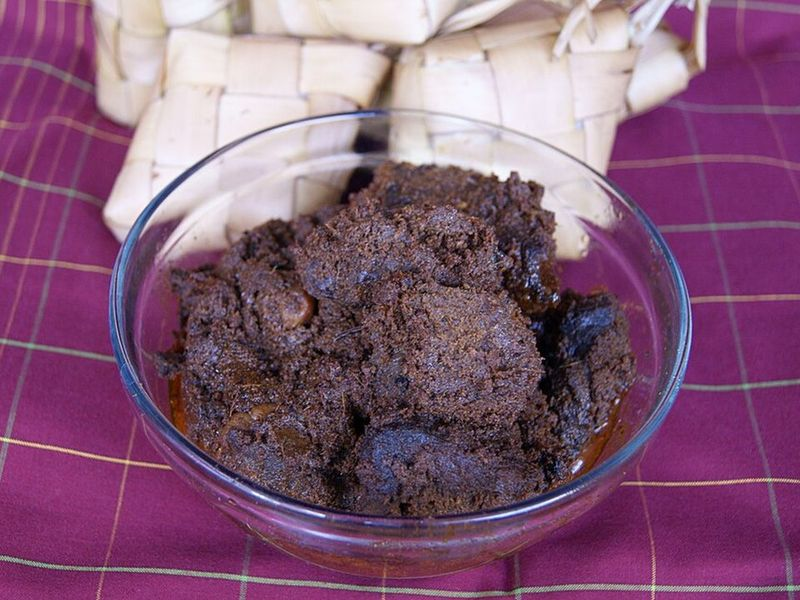

# Slow-Simmered Beef Rendang

Photo: Midori · CC BY 3.0 · [source](https://commons.wikimedia.org/wiki/File:Rendang_daging_sapi_asli_Padang.JPG)

**Dinner** · Indonesian · 210 min · serves 6 · skill 3/3

> West Sumatra's legendary dry curry: chunks of beef simmered for hours in coconut milk and a chili-lemongrass spice paste until the liquid disappears and the meat is dark, tender and coated in fragrant, caramelized spices.

| Per serving | kcal | Protein | Carbs | Fat | Fiber | Sodium | Cost |
| --- | --- | --- | --- | --- | --- | --- | --- |
| | 790 | 36 g | 60 g | 45 g | 2 g | 330 mg | $2.81 |

Contains: beef, spicy

## Ingredients

- 2 lb beef chuck, in 1½-inch cubes
- 1 can coconut milk
- 3 tbsp lemongrass paste
- 1-inch piece ginger, chopped
- 5 garlic cloves
- 1 onion, chopped
- 1 tbsp tamarind concentrate
- 2 cups jasmine rice

From the pantry: 10 dried red chiles (such as guajillo or arbol), 3 tbsp oil, 1 cinnamon stick, 3 star anise, ¼ tsp ground cloves, ½ tsp ground cardamom, ⅓ cup unsweetened shredded coconut, 1 tbsp brown sugar, 1½ tsp salt

## Steps

1. Soak the chiles in boiling water for 15 minutes, drain, stem and seed them. Blend with the onion, garlic, ginger, 2 tbsp of the lemongrass paste and a splash of water into a smooth paste.
2. Toast the shredded coconut in a dry skillet over medium-low, stirring, until deep golden, 4 to 5 minutes. Set aside.
3. Heat 2 tbsp oil in a heavy pot over high and brown the beef in two batches. Remove. Lower the heat to medium-low, add the last 1 tbsp oil and the spice paste, and fry, stirring, until it darkens and smells sweet, 3 to 4 minutes.
4. Return the beef with the coconut milk, ½ cup water, the rest of the lemongrass, the cinnamon, star anise, cloves, cardamom, tamarind, brown sugar and salt. Bring to a gentle simmer, cover and cook on low for 1 hour 15 minutes.
5. Uncover, stir in the toasted coconut and simmer over medium, stirring more often as it thickens, for 40 to 60 minutes, until the sauce has cooked down to a thick paste that clings to fork-tender beef and the oil starts to separate. Start the rice in the last 20 minutes.
6. Fish out the whole spices and serve with rice.

**Tip:** Galangal and finely shredded makrut lime leaves are traditional; add 1 tbsp chopped galangal to the paste and 4 sliced leaves with the coconut milk if your Asian market has them. The final reduction needs your attention: scrape the bottom so it browns, not burns.

Adapted from [RecipeTin Eats](https://www.recipetineats.com/beef-rendang/).

## Storing

Fridge 5 days · freezer up to 3 months. Rendang tastes even better the next day. Reheat covered over low heat with a splash of water.

