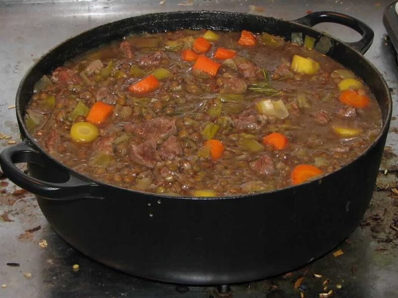

# Classic Beef Stew with Carrots & Potatoes

Photo: FiveRings (talk) · CC BY 3.0 · [source](https://commons.wikimedia.org/wiki/File:Lamb-stew.jpg)

**Dinner** · American comfort · 180 min · serves 6 · skill 2/3

> Fork-tender chunks of chuck braised low and slow with carrots, potatoes and herbs in a rich, glossy gravy. Serve it with crusty bread for mopping.

| Per serving | kcal | Protein | Carbs | Fat | Fiber | Sodium | Cost |
| --- | --- | --- | --- | --- | --- | --- | --- |
| | 775 | 47 g | 64 g | 37 g | 7 g | 1240 mg | $3.62 |

Contains: gluten, beef

## Ingredients

- 2½ lb beef chuck, in 1½-inch cubes
- 2 onions, chopped
- 1 lb carrots, in thick chunks
- 3 celery stalks, sliced
- 1½ lb russet potatoes, in chunks
- 4 garlic cloves, minced
- 4 cups beef broth
- 1 crusty baguette, to serve
- parsley, chopped

From the pantry: 3 tbsp oil, ¼ cup flour, 3 tbsp tomato paste, 1 tbsp red wine vinegar, 1 tsp dried thyme, 2 bay leaves, 2 tsp salt, 1 tsp black pepper

## Steps

1. Pat the beef dry and toss with 1 tsp salt, the pepper and the flour. Brown in batches in the oil in a Dutch oven over medium-high, without crowding, until deeply browned, 4 to 5 minutes per batch. Move to a bowl.
2. Lower the heat to medium, add the onions and celery and cook until softened, 5 minutes. Stir in the garlic and tomato paste for 2 minutes, then the vinegar, scraping up the browned bits.
3. Return the beef with the broth, thyme and bay leaves. Bring to a simmer, cover and cook on low (or in a 325°F oven) for 1½ hours.
4. Add the carrots, potatoes and the remaining salt. Cover and simmer until the beef and vegetables are fork-tender, 45 minutes to 1 hour.
5. Discard the bay leaves, taste for salt and let it rest 10 minutes. Ladle into bowls with parsley and warm bread.

**Tip:** Browning in small batches matters. A crowded pot steams the beef grey instead of building the deep brown crust that flavors the gravy.

## Storing

Fridge 4 days · freezer up to 3 months. Reheat on the stove over medium until simmering, or microwave 2 to 3 minutes, stirring once. Potatoes soften a little after freezing.

