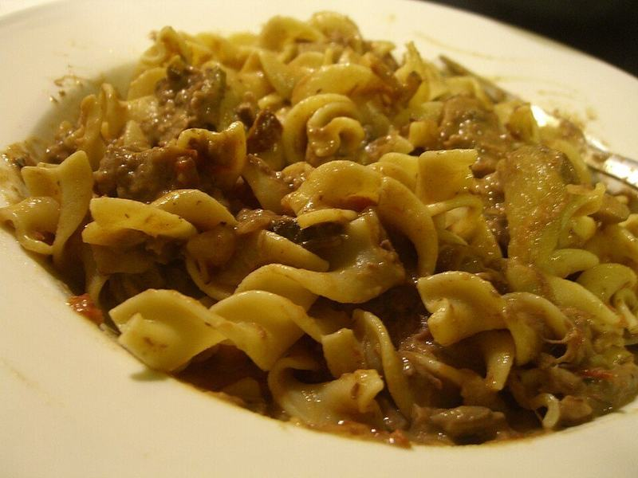

# Beef Stroganoff with Mushrooms over Egg Noodles

Photo: benketaro · CC BY 2.0 · [source](https://commons.wikimedia.org/wiki/File:Beef_stroganoff_with_pasta.jpg)

**Dinner** · Russian & Ukrainian · 40 min · serves 4 · skill 2/3

> Seared strips of tender steak and browned mushrooms in a tangy, silky sour cream gravy, spooned over buttery egg noodles. Classic Sunday comfort ready on a weeknight.

| Per serving | kcal | Protein | Carbs | Fat | Fiber | Sodium | Cost |
| --- | --- | --- | --- | --- | --- | --- | --- |
| | 890 | 57 g | 76 g | 40 g | 5 g | 840 mg | $5.43 |

Contains: gluten, dairy, egg, beef

## Ingredients

- 1½ lb sirloin, in thin strips
- 1 lb sliced mushrooms
- 1 onion, thinly sliced
- 2 garlic cloves, minced
- 1½ cups beef broth
- ¾ cup sour cream, at room temperature
- 3 tbsp butter, divided
- 12 oz wide egg noodles
- parsley, chopped

From the pantry: 2 tbsp oil, 2 tbsp flour, 1 tbsp Dijon mustard, 1 tsp paprika, 1½ tsp salt, ½ tsp black pepper

## Steps

1. Season the beef with 1 tsp salt and the pepper. Sear in batches in the oil in a large skillet over high until browned outside but pink inside, 1 to 2 minutes per batch. Move to a plate.
2. Cook the noodles in salted water until tender, then drain and toss with 1 tbsp butter.
3. Add the remaining butter and the mushrooms to the skillet over medium-high and cook until browned and their liquid has evaporated, 6 to 8 minutes. Add the onion and cook 4 minutes, then the garlic for 30 seconds.
4. Sprinkle in the flour and paprika and stir for 1 minute. Whisk in the broth and mustard and simmer until thickened, 3 to 4 minutes.
5. Turn the heat to low, stir in the sour cream, then return the beef and its juices just to warm through without boiling. Serve over the noodles with parsley.

**Tip:** Never let the sauce boil once the sour cream is in, or it will split. Warm it through gently.

## Storing

Fridge 3 days · freezer not recommended. Reheat gently in a skillet over low with a splash of broth, 4 to 5 minutes, without boiling.

## Other ways to make it

- Chicken
- Shrimp
- Pork
- Tofu
