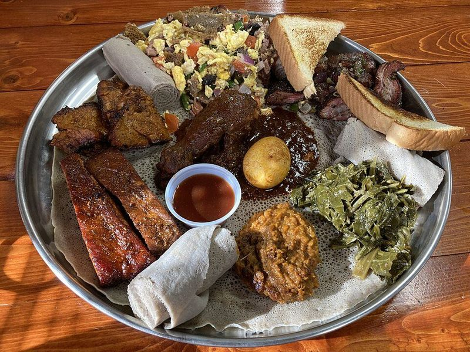

# Ethiopian Beef Tibs with Rosemary & Jalapeños

Photo: Pete unseth · CC BY-SA 4.0 · [source](https://commons.wikimedia.org/wiki/File:Ethiopian_cuisine_fusion.jpg)

**Dinner** · Ethiopian · 30 min · serves 4 · skill 1/3

> Seared cubes of steak tossed in a sizzling pan with red onion, tomato, jalapeño, berbere and spiced butter, with a whiff of rosemary. Ethiopia's quick, festive stir-fry.

| Per serving | kcal | Protein | Carbs | Fat | Fiber | Sodium | Cost |
| --- | --- | --- | --- | --- | --- | --- | --- |
| | 680 | 46 g | 67 g | 25 g | 3 g | 510 mg | $4.42 |

Contains: spicy, dairy, beef

## Ingredients

- 1½ lb sirloin, in 1-inch cubes
- 1 red onion, sliced
- 2 Roma tomatoes, chopped
- 2 jalapeños, sliced
- 3 garlic cloves, grated
- 1 tbsp grated ginger
- 2 tbsp berbere
- 3 tbsp butter
- 1½ cups rice, or store-bought injera

From the pantry: 1 tbsp oil, 1 tsp dried rosemary (or a fresh sprig), ½ tsp ground cardamom, salt, pepper

## Steps

1. Start the rice. Pat the beef dry and season with salt and pepper.
2. Heat the oil in a large skillet over high until smoking. Sear the beef in a single layer, in two batches, until browned on two sides but pink inside, about 3 minutes per batch. Set aside.
3. Lower the heat to medium. Melt the butter with the cardamom and rosemary, then add the onion, garlic and ginger and cook 3 minutes until soft.
4. Stir in the berbere for 30 seconds, then the tomatoes, and cook until they break down into a thick sauce, 5 to 7 minutes.
5. Return the beef and its juices with the jalapeños and toss over medium-high for 2 minutes until coated and hot. Serve straight from the pan with rice or injera.

**Tip:** Warming the butter with cardamom and rosemary is a 2-minute stand-in for niter kibbeh; if you find niter kibbeh at an Ethiopian market, use it instead.

Adapted from [Sims Home Kitchen](https://simshomekitchen.com/tibs/).

## Storing

Fridge 3 days · freezer up to 2 months. Reheat in a skillet over medium-high just until hot, 2 to 3 minutes, so the beef doesn't toughen.

