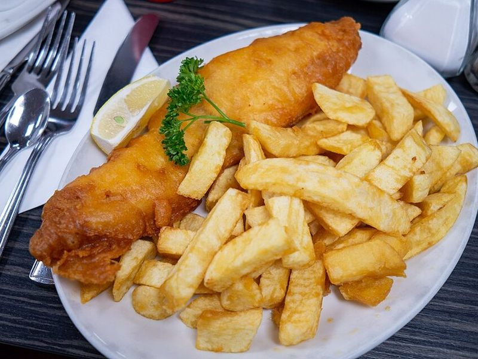

# Beer-Battered Fish & Chips with Mushy Peas

Photo: Matthias Meckel · CC BY-SA 4.0 · [source](https://commons.wikimedia.org/wiki/File:Fish_and_chips_blackpool.jpg)

**Dinner** · British & Irish · 60 min · serves 4 · skill 2/3

> Chip-shop fish at home: thick cod fillets in a light, crackling beer batter with fat, fluffy double-fried chips and minty mushy peas. Douse with malt vinegar and plenty of salt.

| Per serving | kcal | Protein | Carbs | Fat | Fiber | Sodium | Cost |
| --- | --- | --- | --- | --- | --- | --- | --- |
| | 645 | 43 g | 79 g | 18 g | 12 g | 520 mg | $3.32 |

Contains: fish, gluten, dairy

## Ingredients

- 1½ lb thick cod or haddock fillets, in 4 pieces
- 3 lb russet potatoes (4 large)
- 12 oz frozen peas
- 1 tbsp butter
- a few mint leaves (optional)
- 1 lemon, in wedges

From the pantry: 1 cup flour plus ¼ cup for dredging, 1 tsp baking powder, 1¼ cups very cold light beer, oil for frying, malt vinegar to serve, salt

## Steps

1. Cut the potatoes into thick ½-inch chips, rinse well and pat completely dry. Heat 2 to 3 inches of oil in a heavy pot to 325°F and fry the chips in batches until soft and pale, 5 to 6 minutes. Drain on a rack.
2. Simmer the peas in a little salted water for 4 minutes, drain, then mash roughly with the butter, mint and salt. Keep warm.
3. Raise the oil to 375°F and fry the chips again in batches until deep golden and crisp, 2 to 3 minutes. Salt them and keep warm in a 200°F oven.
4. Whisk the flour, baking powder and ½ tsp salt, then whisk in the cold beer until smooth. Pat the fish dry, season, and dredge in the extra flour.
5. Dip each piece in the batter, let the excess drip off and lower it gently into the 360°F oil, away from you. Fry until puffed and golden and the fish flakes, 5 to 7 minutes. Drain on a rack, salt, and serve with chips, peas, lemon and vinegar.

**Tip:** Mix the batter right before frying and keep the beer ice cold; the cold bubbly batter hitting hot oil is what makes it shatter-crisp. Sparkling water works if you don't cook with beer.

Adapted from [The Daring Gourmet](https://www.daringgourmet.com/fish-and-chips/).

## Storing

Fridge 1 days · freezer not recommended. Fried fish is best right away. Re-crisp leftovers on a rack in a 400°F oven or air fryer for 6 to 8 minutes.

