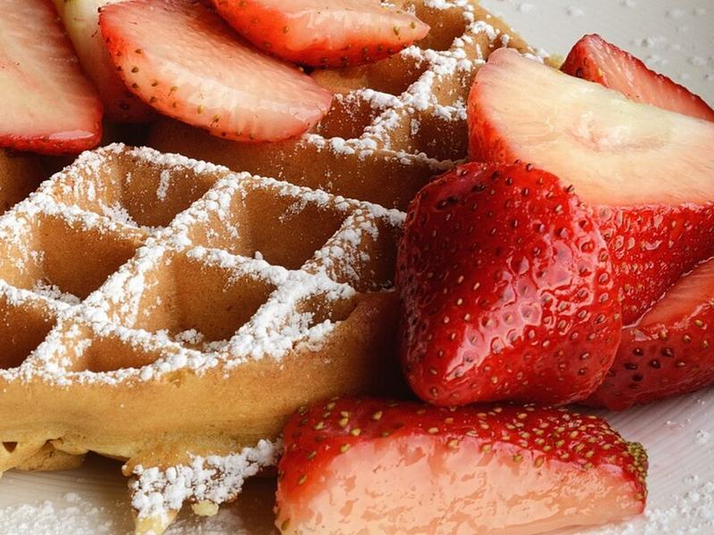

# Crisp Buttermilk Belgian Waffles with Berries

Photo: Ralph Daily · CC BY 2.0 · [source](https://commons.wikimedia.org/wiki/File:Waffle_with_strawberries_and_confectioner%27s_sugar.jpg)

**Breakfast** · American comfort · 35 min · serves 4 · skill 2/3

> Deep-pocketed waffles that are shatteringly crisp outside and airy inside, thanks to whipped egg whites in a buttermilk batter. Piled with fresh blueberries and maple.

| Per serving | kcal | Protein | Carbs | Fat | Fiber | Sodium | Cost |
| --- | --- | --- | --- | --- | --- | --- | --- |
| | 580 | 14 g | 83 g | 22 g | 3 g | 590 mg | $1.66 |

Contains: gluten, egg, dairy

## Ingredients

- 2 cups all-purpose flour
- 2 cups buttermilk
- 2 eggs, separated
- 6 tbsp butter, melted
- 1 pint fresh blueberries
- ¼ cup maple syrup

From the pantry: 2 tbsp sugar, 2 tsp baking powder, ½ tsp baking soda, 1 tsp vanilla, ½ tsp salt

## Steps

1. Heat a Belgian waffle iron and the oven to 200°F with a rack set on a baking sheet. Whisk the flour, sugar, baking powder, baking soda and salt in a large bowl.
2. Whisk the buttermilk, egg yolks, melted butter and vanilla, then stir into the dry ingredients until just combined. The batter should be thick and a little lumpy.
3. Beat the egg whites in a clean bowl until they hold soft peaks, about 2 minutes with a mixer. Gently fold them into the batter in two additions.
4. Brush the iron lightly with oil and cook the waffles according to your iron, usually 4 to 5 minutes, until deep golden and the steam slows to a wisp.
5. Hold finished waffles in a single layer on the rack in the oven so they stay crisp. Serve with blueberries and maple syrup.

**Tip:** Don't stack hot waffles. Steam softens them in seconds; a single layer on a rack in a low oven keeps every one crisp.

## Storing

Fridge 3 days · freezer up to 3 months. Freeze in a single layer, then bag. Reheat straight from frozen in a toaster or a 375°F oven for 5 to 7 minutes.

