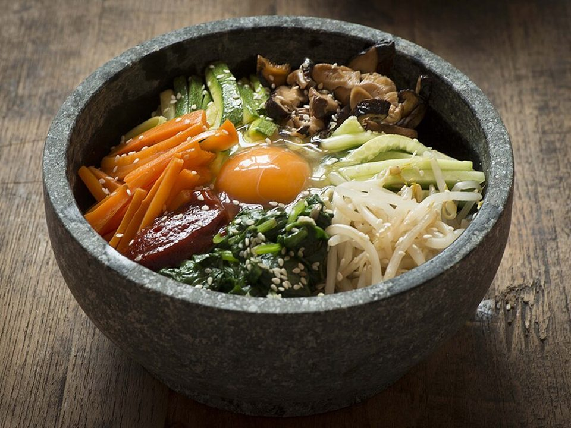

# Beef Bibimbap

Photo: Sous Chef · CC BY 2.0 · [source](https://commons.wikimedia.org/wiki/File:Dolsot-bibimbap.jpg)

**Dinner** · Korean · 35 min · serves 4 · skill 2/3

> Rice topped with savory beef, sesame spinach, carrots, bean sprouts and cucumber, a fried egg and sweet-spicy gochujang sauce. Mix it all up.

| Per serving | kcal | Protein | Carbs | Fat | Fiber | Sodium | Cost |
| --- | --- | --- | --- | --- | --- | --- | --- |
| | 815 | 37 g | 78 g | 40 g | 6 g | 1650 mg | $3.36 |

Contains: beef, egg, gluten, sesame, spicy

## Ingredients

- 1 lb ground beef
- 3 tbsp soy sauce
- 1 tbsp honey
- 4 garlic cloves
- 5 oz spinach
- 2 carrots, in matchsticks
- 12 oz bean sprouts
- 1 cucumber
- 4 eggs
- 3 tbsp gochujang
- 1½ cups short-grain rice
- sesame seeds

From the pantry: 2 tbsp sesame oil, 1 tbsp rice vinegar, 1 tsp sugar, 1 tbsp oil, salt

## Steps

1. Cook the rice. Stir the gochujang with 1 tbsp sesame oil, the vinegar, sugar and 1 tbsp water for the sauce.
2. Brown the beef with half the garlic, then add the soy and honey and cook until glazy.
3. Blanch the bean sprouts 1 minute and the spinach 20 seconds. Squeeze dry and season each with sesame oil, garlic and salt. Sauté the carrots 2 minutes.
4. Fry the eggs sunny-side up. Slice the cucumber.
5. Arrange everything in sections over the rice, top with the egg, sesame and a big spoon of sauce. Mix before eating.

**Tip:** Use a hot cast-iron or stone bowl with a little sesame oil for crispy rice on the bottom (dolsot style).

## Storing

Fridge 3 days · freezer not recommended. Store components separately. Microwave the rice and beef, add cold veg and a fresh egg.

## Other ways to make it

- Ground turkey
- Ground pork
- Italian sausage
- Lentils (veg)
