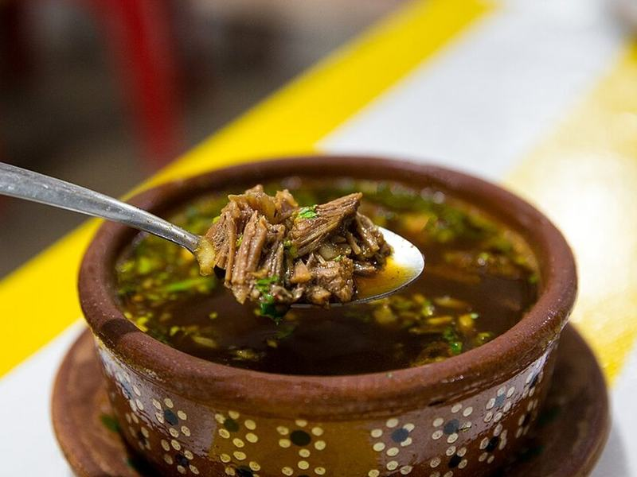

# Birria-Style Beef Tacos with Consommé

Photo: City Foodsters · CC BY 2.0 · [source](https://commons.wikimedia.org/wiki/File:Tacos_de_Barba_Birria_8.jpg)

**Dinner** · Mexican & Tex-Mex · 210 min · serves 6 · skill 3/3

> A weekend project worth every minute: chuck roast braised in a smoky chile broth until it falls apart, tucked into tortillas dipped in the red fat, crisped with melty cheese and dunked in the consommé.

| Per serving | kcal | Protein | Carbs | Fat | Fiber | Sodium | Cost |
| --- | --- | --- | --- | --- | --- | --- | --- |
| | 885 | 63 g | 41 g | 51 g | 7 g | 2240 mg | $4.82 |

Contains: dairy

## Ingredients

- 3 lb boneless chuck roast, in 3-inch chunks
- 19 oz red enchilada sauce
- 3 chipotles in adobo plus 2 tbsp sauce
- 4 cups beef broth
- 2 onions (1 quartered, 1 finely diced)
- 8 garlic cloves
- 18 corn tortillas
- 3 cups shredded mozzarella or Oaxaca
- 1 bunch cilantro, chopped
- 4 limes

From the pantry: 1 tbsp oil, 1 tbsp cumin, 2 tsp dried oregano, 2 bay leaves, 1 cinnamon stick (optional), 1 tbsp vinegar, salt

## Steps

1. Season the beef with 2 tsp salt and brown it hard in the oil in a Dutch oven, in batches. Set aside.
2. Blend the enchilada sauce, chipotles, garlic, cumin, oregano, vinegar and 1 cup broth. Pour into the pot with the remaining broth, the quartered onion, bay leaves and cinnamon. Add the beef.
3. Cover and braise at 325°F for 3 hours, until the beef shreds easily with a fork. Shred it and skim the red fat from the top into a bowl. Season the broth (the consommé) with salt and lime.
4. Heat a griddle or skillet over medium-high. Dip a tortilla in the reserved fat, lay it in the pan, top with cheese and beef, fold and cook until crisp on both sides, about 2 minutes per side.
5. Serve the tacos with cups of hot consommé topped with diced onion and cilantro, and lime wedges for squeezing.

**Tip:** Make the beef a day ahead. The fat sets on top in the fridge and lifts right off for dipping.

## Storing

Fridge 4 days · freezer up to 3 months. Store meat in its consommé. Reheat the consommé on the stove and griddle fresh tacos.

