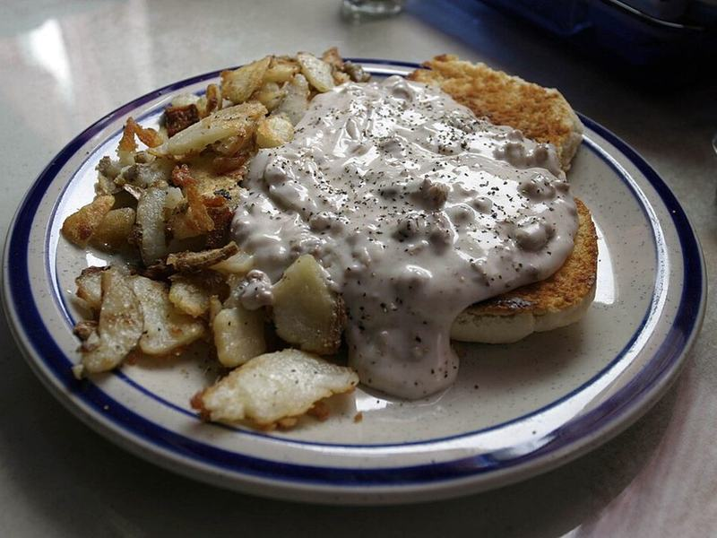

# Buttermilk Biscuits with Turkey Sausage Gravy

Photo: No machine-readable author provided. Kaszeta assumed (based on copyright claims) · Public domain · [source](https://commons.wikimedia.org/wiki/File:Biscuits-and-gravy.jpg)

**Breakfast** · Southern & soul food · 50 min · serves 6 · skill 2/3

> Tall, flaky, from-scratch buttermilk biscuits smothered in a peppery, sage-scented gravy made with homemade turkey sausage.

| Per serving | kcal | Protein | Carbs | Fat | Fiber | Sodium | Cost |
| --- | --- | --- | --- | --- | --- | --- | --- |
| | 600 | 26 g | 55 g | 31 g | 2 g | 490 mg | $1.12 |

Contains: gluten, dairy

## Ingredients

- 2¾ cups all-purpose flour (2½ cups for biscuits, ¼ cup for gravy)
- 10 tbsp cold butter (8 for biscuits, 2 for gravy)
- 1 cup cold buttermilk
- 1 lb ground turkey
- 3 cups milk

From the pantry: 1 tbsp baking powder, ½ tsp baking soda, 1 tsp sugar, 1 tsp dried sage, ½ tsp fennel seed, ½ tsp red pepper flakes, 1 tsp black pepper, 1½ tsp salt, 1 tbsp oil

## Steps

1. Heat the oven to 450°F. Whisk 2½ cups flour, the baking powder, baking soda, sugar and 1 tsp salt. Grate in 8 tbsp frozen or very cold butter and toss until coated.
2. Stir in the buttermilk just until a shaggy dough forms. Pat it out on a floured counter 1 inch thick, fold in thirds, pat out again and repeat once. Cut into 6 to 8 biscuits, place touching on a baking sheet and bake 13 to 15 minutes, until tall and golden.
3. While they bake, mix the turkey with the sage, fennel, pepper flakes and ½ tsp salt. Brown in the oil in a large skillet over medium-high, breaking it into small crumbles, 6 to 7 minutes.
4. Add 2 tbsp butter to the turkey, then sprinkle ¼ cup flour over and stir for 1 minute to cook the raw taste out.
5. Slowly pour in the milk, stirring, and simmer until thick enough to coat a spoon, 4 to 5 minutes. Season with the black pepper and more salt. Split the biscuits and spoon the gravy over.

**Tip:** Turkey is much leaner than pork sausage, so the extra butter in the gravy matters. It replaces the drippings that usually carry the flavor.

## Storing

Fridge 3 days · freezer up to 3 months. Store biscuits and gravy separately. Rewarm gravy with a splash of milk; warm biscuits in a 350°F oven for 5 minutes. Biscuits freeze well.

## Other ways to make it

- Ground beef
- Ground pork
- Italian sausage
- Lentils (veg)
