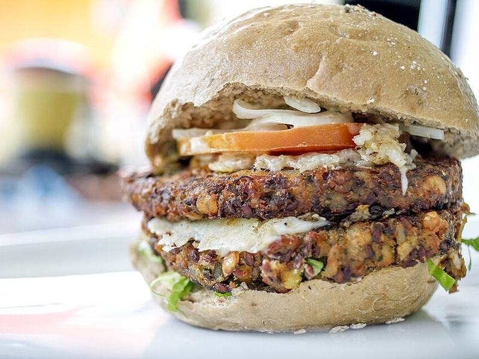

# Smoky Black Bean Burgers

Photo: Roee Shpernik · CC BY-SA 4.0 · [source](https://commons.wikimedia.org/wiki/File:%D7%94%D7%9E%D7%91%D7%95%D7%A8%D7%92%D7%A8_%D7%98%D7%91%D7%A2%D7%95%D7%A0%D7%99.jpg)

**Dinner** · American comfort · 35 min · serves 4 · skill 1/3

> Hearty, crisp-edged veggie burgers made from dried-out black beans, cheddar and smoky spices, topped with avocado and chipotle mayo.

| Per serving | kcal | Protein | Carbs | Fat | Fiber | Sodium | Cost |
| --- | --- | --- | --- | --- | --- | --- | --- |
| | 880 | 30 g | 89 g | 48 g | 19 g | 1510 mg | $1.93 |

Contains: dairy, gluten, egg

## Ingredients

- 2 cans black beans, drained and patted dry
- ¾ cup panko
- 1 egg
- 1 cup shredded cheddar
- ½ cup corn
- 4 buns
- 2 avocados
- 1 tbsp adobo sauce
- lettuce

From the pantry: 2 tsp smoked paprika, 1 tsp cumin, 2 tbsp oil, ⅓ cup mayo, salt

## Steps

1. Spread the beans on a sheet pan and bake at 350°F for 15 minutes to dry them out. This stops mushy burgers.
2. Mash the beans roughly, leaving some whole. Mix in the panko, egg, cheddar, corn, paprika, cumin and salt.
3. Form 4 patties and chill 10 minutes.
4. Fry in the oil over medium heat until crusty, 4 to 5 minutes per side.
5. Stir the adobo into the mayo. Serve the burgers on toasted buns with chipotle mayo, lettuce and avocado.

**Tip:** Patties freeze well between parchment. Cook from frozen, adding 2 minutes per side.

## Storing

Fridge 4 days · freezer up to 3 months. Freeze uncooked or cooked patties between parchment. Reheat in a skillet.

