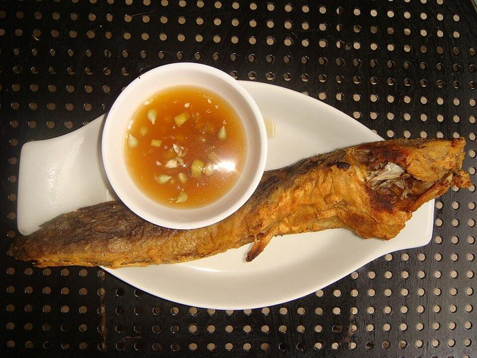

# Blackened Catfish with Cajun Dirty Rice

Photo: Ramon FVelasquez · CC0 · [source](https://commons.wikimedia.org/wiki/File:Catfishjf.JPG)

**Dinner** · Southern & Cajun · 40 min · serves 4 · skill 2/3

> Catfish fillets crusted in smoky, spicy Cajun seasoning and seared in butter until dark and fragrant, served over savory dirty rice studded with pork and the holy trinity.

| Per serving | kcal | Protein | Carbs | Fat | Fiber | Sodium | Cost |
| --- | --- | --- | --- | --- | --- | --- | --- |
| | 730 | 43 g | 58 g | 36 g | 4 g | 1560 mg | $3.48 |

Contains: fish, pork, dairy, spicy

## Ingredients

- 4 catfish fillets (about 1½ lb)
- 3 tbsp Cajun seasoning, divided
- 3 tbsp butter, melted
- 1¼ cups long-grain rice
- ½ lb ground pork
- 1 onion, diced
- 1 green bell pepper, diced
- 2 celery stalks, diced
- 3 garlic cloves, minced
- 2½ cups chicken broth
- green onions, sliced
- 1 lemon, in wedges

From the pantry: 1 tbsp oil, 1 tsp smoked paprika, ½ tsp dried thyme, ½ tsp salt

## Steps

1. For the dirty rice, brown the pork in the oil in a saucepan over medium-high, breaking it up, 5 minutes. Add the onion, pepper and celery and cook until soft, 5 minutes, then the garlic and 1 tbsp of the Cajun seasoning for 1 minute.
2. Stir in the rice to coat, then add the broth and salt. Bring to a boil, cover and simmer on low until tender, 18 minutes. Rest 5 minutes off the heat, then fluff with half the green onions.
3. Meanwhile pat the catfish very dry. Mix the remaining Cajun seasoning with the paprika and thyme. Brush the fillets with half the melted butter and press the spice mix over both sides.
4. Heat a cast-iron skillet over high until smoking hot and turn on the vent fan. Lay in the fillets and drizzle with the remaining butter. Cook until a dark crust forms, 2 to 3 minutes per side, until the fish flakes easily.
5. Serve the catfish over the dirty rice with the rest of the green onions and lemon wedges.

**Tip:** Blackening makes a lot of smoke, so open a window. For a lighter plate, swap the rice for vinegar coleslaw.

## Storing

Fridge 2 days · freezer not recommended. Reheat rice covered in the microwave with a splash of water; warm the fish uncovered at 350°F for 8 to 10 minutes.

## Other ways to make it

- Ground beef
- Ground turkey
- Italian sausage
- Lentils (veg)
