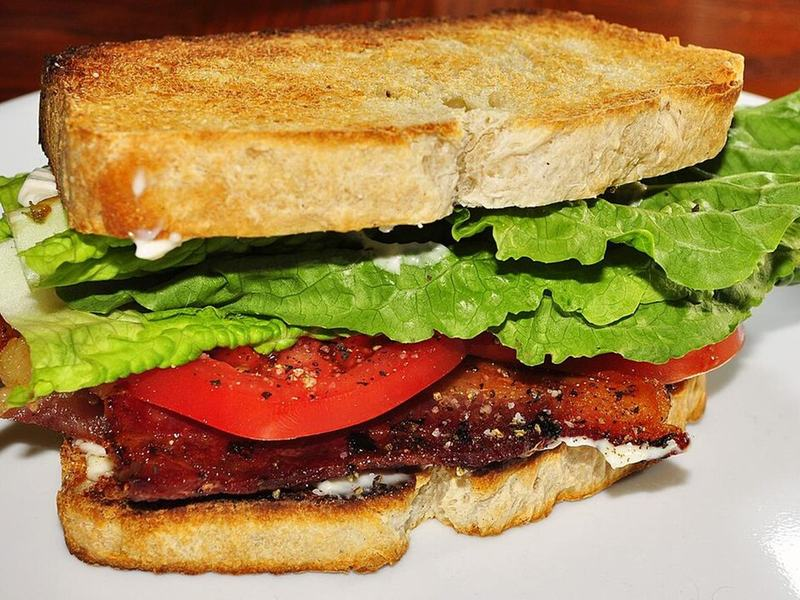

# BLTs with Avocado & Garlic Mayo

Photo: jeffreyw · CC BY 2.0 · [source](https://commons.wikimedia.org/wiki/File:Mmm..._BLT_for_me!_(5487341380).jpg)

**Lunch** · American comfort · 15 min · serves 4 · skill 1/3

> Thick oven-crisp bacon, juicy salted tomatoes, crunchy romaine and creamy avocado on toasted sourdough with lemony garlic mayo.

| Per serving | kcal | Protein | Carbs | Fat | Fiber | Sodium | Cost |
| --- | --- | --- | --- | --- | --- | --- | --- |
| | 620 | 22 g | 49 g | 39 g | 9 g | 1400 mg | $2.55 |

Contains: pork, gluten, egg

## Ingredients

- 12 slices thick-cut bacon
- 4 ripe tomatoes, sliced
- 1 romaine heart
- 2 avocados
- 8 slices sourdough
- 1 small garlic clove, grated
- ½ lemon

From the pantry: ⅓ cup mayo, flaky salt, pepper

## Steps

1. Bake the bacon on a rack at 400°F for 15 to 18 minutes until crisp.
2. Salt the tomato slices and let them sit 5 minutes.
3. Stir the mayo with the garlic and a squeeze of lemon.
4. Toast the bread and spread with garlic mayo.
5. Layer lettuce, tomatoes, avocado and 3 bacon slices per sandwich. Close, press and slice.

**Tip:** Salting the tomatoes a few minutes ahead makes them taste much more like tomato.

## Storing

Fridge 0 days · freezer not recommended. Best assembled fresh. Cooked bacon keeps 5 days.

