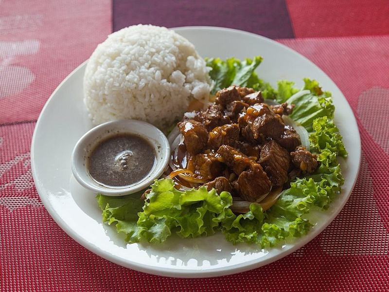

# Bò Lúc Lắc (Vietnamese Shaking Beef)

Photo: Marcin Konsek · CC BY-SA 4.0 · [source](https://commons.wikimedia.org/wiki/File:2016_Phnom_Penh,_Kambod%C5%BCa%C5%84ski_Lok_Lak_(02).jpg)

**Dinner** · Vietnamese · 35 min · serves 4 · skill 2/3

> Cubes of marinated sirloin seared hard in a hot wok and "shaken" with butter, garlic and onion, then piled over crisp greens and tomatoes with a lime-pepper dip.

| Per serving | kcal | Protein | Carbs | Fat | Fiber | Sodium | Cost |
| --- | --- | --- | --- | --- | --- | --- | --- |
| | 720 | 48 g | 75 g | 26 g | 4 g | 1370 mg | $5.16 |

Contains: beef, gluten, dairy, fish, shellfish

## Ingredients

- 1½ lb top sirloin, in 1-inch cubes
- 2 tbsp oyster sauce
- 2 tbsp soy sauce
- 1 tbsp fish sauce
- 6 garlic cloves, minced
- 1 red or yellow onion, in 1-inch pieces
- 2 tbsp butter
- 5 oz watercress or spring mix
- 1 pint cherry tomatoes, halved
- ½ cucumber, sliced
- 2 limes
- 1½ cups jasmine rice

From the pantry: 1 tbsp sugar, 1 tsp cornstarch, 2 tbsp oil, 1 tbsp rice vinegar, 1 tsp black pepper, salt

## Steps

1. Toss the beef with the oyster sauce, soy sauce, fish sauce, half the garlic, 2 tsp sugar, the cornstarch and ½ tsp pepper. Marinate 15 to 30 minutes. Start the rice.
2. Toss the onion with the vinegar, the remaining sugar and a pinch of salt. Arrange the greens, tomatoes and cucumber on a platter. For the dip, mix the juice of 1 lime with ½ tsp salt and ½ tsp pepper in a small dish.
3. Heat 1 tbsp oil in a wok or cast-iron skillet over high heat until smoking. Add half the beef in a single layer and leave it 1 minute to sear, then shake the pan and keep tossing until browned outside and pink inside, 2 to 3 minutes more. Repeat with the rest of the oil and beef.
4. Return all the beef to the pan, turn the heat to medium and add the butter, the remaining garlic and the drained onion. Shake and toss 1 minute, until the butter is foamy and the onion is just softened.
5. Pile the beef and its pan juices over the greens. Serve with rice, lime wedges and the lime-pepper dip for dunking.

**Tip:** Don't crowd the pan. If the beef steams instead of sizzling it turns gray, so cook it in two batches.

## Storing

Fridge 2 days · freezer not recommended. Store the beef apart from the salad. Warm it briefly in a hot skillet so it doesn't overcook.

## Other ways to make it

- Chicken
- Shrimp
- Pork
- Tofu
