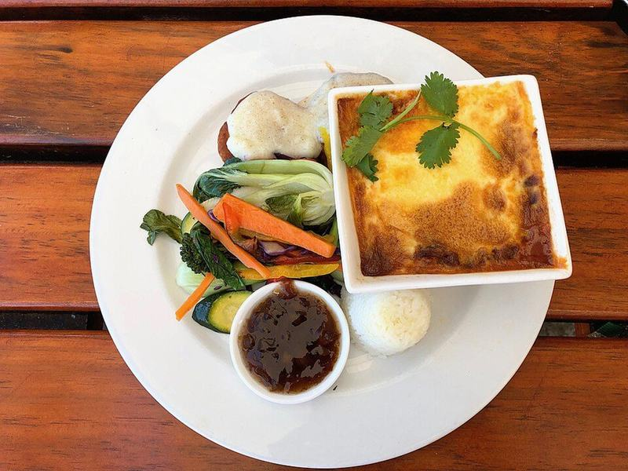

# South African Bobotie with Yellow Rice

Photo: Olga Ernst · CC BY-SA 4.0 · [source](https://commons.wikimedia.org/wiki/File:Bobotie,_South_African_dish.jpg)

**Dinner** · South African · 75 min · serves 5 · skill 2/3

> Gently curried ground beef with sweet apricots and a hint of lemon, baked under a silky savory custard. Cape Malay home cooking at its coziest, with turmeric-gold rice.

| Per serving | kcal | Protein | Carbs | Fat | Fiber | Sodium | Cost |
| --- | --- | --- | --- | --- | --- | --- | --- |
| | 820 | 37 g | 77 g | 41 g | 5 g | 520 mg | $2.50 |

Contains: gluten, dairy, egg, beef

## Ingredients

- 1½ lb ground beef or ground turkey
- 2 onions, finely diced
- 3 garlic cloves, minced
- 2 tbsp curry powder
- 2 slices bread
- 1½ cups milk, divided
- 3 eggs
- ⅓ cup dried apricots, chopped
- 1 lemon, zested and juiced
- 1½ cups basmati rice

From the pantry: 2 tbsp oil, 1 tbsp butter, 1 tbsp brown sugar, 1 tsp turmeric, 4 bay leaves, 2 tsp salt, ½ tsp black pepper

## Steps

1. Heat the oven to 350°F. Soak the bread in ½ cup of the milk. Cook the onions in the oil in a large skillet over medium until soft and golden, 8 minutes, then add the garlic and curry powder for 1 minute.
2. Add the beef and cook, breaking it up, until no pink remains, 6 to 8 minutes. Off the heat, mash in the soaked bread, the apricots, brown sugar, lemon zest and juice, 1½ tsp salt and the pepper.
3. Pack the mixture into a buttered 8x8 or 9-inch baking dish. Whisk the eggs with the remaining 1 cup milk and a pinch of salt, pour it over the top and tuck in the bay leaves.
4. Bake until the custard is set and golden, 30 to 35 minutes.
5. Meanwhile cook the rice with the turmeric, butter and a pinch of salt. Let the bobotie rest 5 minutes and serve with the yellow rice.

**Tip:** Pour the custard over the back of a spoon so it settles on top of the meat in an even layer instead of sinking in.

## Storing

Fridge 4 days · freezer up to 3 months. Reheat covered at 350°F for 15 to 20 minutes, or microwave portions 2 minutes.

## Other ways to make it

- Ground turkey
- Ground pork
- Italian sausage
- Lentils (veg)
