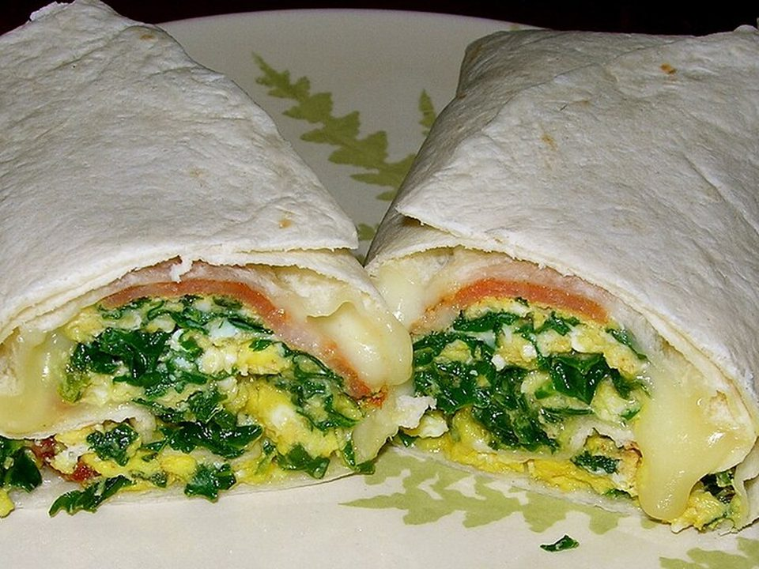

# Freezer-Friendly Breakfast Burritos

Photo: Cajsa Lilliehook from Portland · CC BY-SA 2.0 · [source](https://commons.wikimedia.org/wiki/File:Breakfast_burrito_(cropped).jpg)

**Breakfast** · Tex-Mex · 40 min · serves 8 · skill 2/3

> Crispy potatoes, sausage, soft scrambled eggs and melty cheese wrapped tight and frozen. Grab one, microwave, go.

| Per serving | kcal | Protein | Carbs | Fat | Fiber | Sodium | Cost |
| --- | --- | --- | --- | --- | --- | --- | --- |
| | 625 | 30 g | 42 g | 38 g | 3 g | 1450 mg | $1.72 |

Contains: egg, dairy, gluten, pork

## Ingredients

- 10 eggs
- 1 lb breakfast or Italian sausage
- 1½ lb baby potatoes, diced small
- 2 cups shredded Mexican cheese
- 8 large flour tortillas
- 1 cup salsa, for serving

From the pantry: 2 tbsp oil, salt, pepper

## Steps

1. Roast the potatoes with the oil and salt at 425°F for 25 minutes, until crisp.
2. Brown the sausage in a large skillet, breaking it up. Move to a bowl.
3. Scramble the eggs gently in the same skillet until just set. Season.
4. Warm the tortillas. Fill each with potatoes, sausage, eggs and cheese, fold in the sides and roll tight.
5. Eat now with salsa, or wrap each in foil and freeze. Reheat from frozen: unwrap, cover with a damp paper towel and microwave 2 minutes, turning once.

**Tip:** Let the fillings cool before rolling for the freezer, so the tortillas don't go soggy.

## Storing

Fridge 4 days · freezer up to 3 months. Wrap each in foil. From frozen, unwrap, cover with a damp paper towel and microwave 2 to 2½ minutes, turning once.

## Other ways to make it

- Ground beef
- Ground turkey
- Ground pork
- Lentils (veg)
