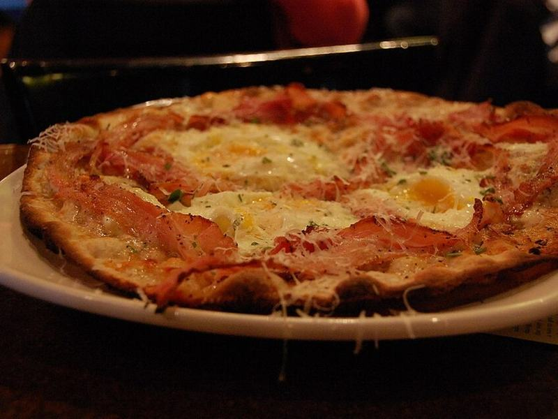

# Sausage, Egg & Cheese Sheet-Pan Breakfast Pizza

Photo: stu_spivack · CC BY-SA 2.0 · [source](https://commons.wikimedia.org/wiki/File:Breakfast_pizza_(3382088989).jpg)

**Breakfast** · American comfort · 35 min · serves 6 · skill 1/3

> A crisp-bottomed sheet-pan pizza loaded with browned breakfast sausage, peppers, two cheeses and eggs baked right on top until the yolks are just set.

| Per serving | kcal | Protein | Carbs | Fat | Fiber | Sodium | Cost |
| --- | --- | --- | --- | --- | --- | --- | --- |
| | 595 | 30 g | 42 g | 34 g | 2 g | 1210 mg | $1.58 |

Contains: gluten, egg, dairy, pork

## Ingredients

- 1 lb pizza dough, room temperature
- 8 oz breakfast sausage (pork or turkey)
- 6 eggs
- 2 cups shredded mozzarella
- ½ cup shredded sharp cheddar
- 1 bell pepper, diced
- 2 green onions, sliced

From the pantry: 2 tbsp olive oil, ½ tsp red pepper flakes, salt, pepper

## Steps

1. Heat the oven to 475°F with a rack in the lower third. Oil a rimmed sheet pan with 1 tbsp olive oil and stretch the dough to fill it; if it springs back, rest 10 minutes and stretch again.
2. Brown the sausage and pepper in a skillet over medium-high, breaking up the meat, until no pink remains, 6 to 7 minutes.
3. Brush the dough with the remaining oil and bake alone for 6 minutes, until puffed and just starting to color.
4. Scatter the mozzarella, cheddar and sausage mixture over, leaving 6 small gaps. Crack an egg into each gap and season the eggs with salt and pepper.
5. Bake 9 to 12 minutes, until the crust is golden underneath and the egg whites are set. Sprinkle with green onions and pepper flakes and cut into squares.

**Tip:** Par-baking the crust before adding the eggs keeps the middle from going soggy and means the yolks stay runny by the time the crust is done.

## Storing

Fridge 3 days · freezer not recommended. Reheat slices in a 400°F oven or skillet for 6 to 8 minutes; yolks will firm up.

