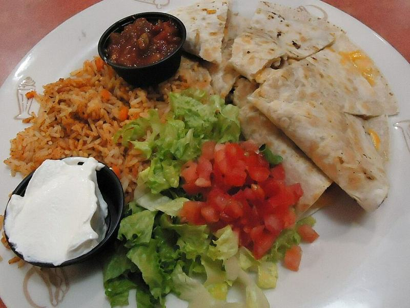

# Turkey Sausage, Egg & Cheese Breakfast Quesadillas

Photo: Tomwsulcer · CC0 · [source](https://commons.wikimedia.org/wiki/File:Dinner_at_Friendlys_restaurant_quesedillas.jpg)

**Breakfast** · Mexican & Tex-Mex · 30 min · serves 4 · skill 1/3

> Crisp, golden tortillas folded around soft scrambled eggs, homemade smoky turkey sausage and melty Mexican cheese, with salsa for dipping.

| Per serving | kcal | Protein | Carbs | Fat | Fiber | Sodium | Cost |
| --- | --- | --- | --- | --- | --- | --- | --- |
| | 700 | 46 g | 53 g | 34 g | 3 g | 1780 mg | $2.23 |

Contains: gluten, egg, dairy

## Ingredients

- 1 lb ground turkey
- 6 eggs
- 1 cup shredded Mexican cheese
- 8 flour tortillas
- 2 green onions, sliced
- 1 cup salsa, for serving

From the pantry: 1 tsp oil, 1 tsp dried sage, ½ tsp fennel seed, 1 tsp smoked paprika, ½ tsp garlic powder, ¼ tsp red pepper flakes, 1 tsp salt, pepper

## Steps

1. Mix the turkey with the sage, fennel, paprika, garlic powder, pepper flakes, ¾ tsp salt and some pepper. Brown it in the oil in a large nonstick skillet over medium-high, breaking it up, until no pink remains, 6 to 7 minutes. Move to a bowl.
2. Lower the heat to medium-low. Beat the eggs with a pinch of salt, pour into the skillet and stir gently until softly set, 2 minutes. Stir in the turkey and green onions.
3. Wipe the skillet and set it over medium. Lay in a tortilla, sprinkle cheese over half, top with an eighth of the filling and a little more cheese, then fold it closed.
4. Cook until golden and crisp, 2 minutes per side, pressing gently with a spatula so the cheese melts and seals it. Repeat with the rest, two at a time if they fit.
5. Cut each half-moon in two and serve with salsa.

**Tip:** Make a double batch of the filling and freeze the folded, uncooked quesadillas between parchment. Cook from frozen over medium-low, 4 minutes per side.

## Storing

Fridge 3 days · freezer up to 2 months. Re-crisp in a dry skillet over medium-low, 3 minutes per side, or an air fryer at 375°F for 5 minutes.

## Other ways to make it

- Ground beef
- Ground pork
- Italian sausage
- Lentils (veg)
