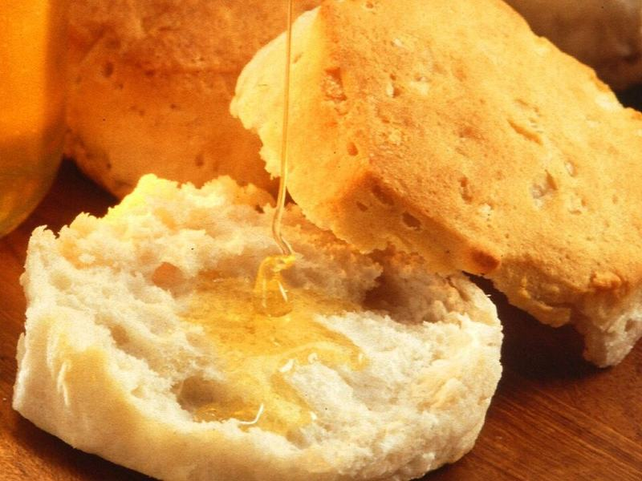

# Turkey Sausage, Egg & Cheddar Homemade Biscuits

Photo: User:-sche cropped a public domain image · Public domain · [source](https://commons.wikimedia.org/wiki/File:Biscuit_which_has_been_broken_open.jpg)

**Breakfast** · American comfort · 45 min · serves 6 · skill 2/3

> Your breakfast sandwich, your way. Pick the protein (including homemade turkey sausage), egg, cheese and bread, from scratch buttermilk biscuits to English muffins. Make 6 at once and freeze extras.

| Per serving | kcal | Protein | Carbs | Fat | Fiber | Sodium | Cost |
| --- | --- | --- | --- | --- | --- | --- | --- |
| | 610 | 33 g | 35 g | 37 g | 1 g | 640 mg | $1.42 |

Contains: gluten, egg, dairy

## Ingredients

- 2 cups all-purpose flour, plus more for dusting
- 6 tbsp cold butter, cubed
- ¾ cup cold buttermilk
- 1 lb ground turkey (for 6 homemade sausage patties)
- 6 eggs
- 6 slices cheddar or American

From the pantry: 1 tbsp baking powder, ½ tsp baking soda, 1 tsp salt, 1 tsp sugar; Sausage seasoning: 1 tsp dried sage, ½ tsp dried thyme, ½ tsp fennel seed (crushed), ½ tsp garlic powder, 1 tsp maple syrup or brown sugar, ¾ tsp salt, ½ tsp black pepper, pinch of red pepper flakes, 1 tbsp oil; 1 tbsp butter

## Steps

1. Make the biscuits: heat the oven to 425°F. Whisk the flour, baking powder, baking soda, salt and sugar. Cut in the cold butter with a fork or your fingertips until it looks like coarse crumbs with some pea-size pieces.
2. Stir in the buttermilk just until a shaggy dough forms. Pat into a rectangle on a floured counter, fold it in thirds like a letter, pat out and fold again twice more (this makes flaky layers). Pat to 1 inch thick and cut 6 biscuits with a floured cutter. Don't twist the cutter.
3. Bake on a sheet pan, touching, 12 to 15 minutes until tall and golden. Brush the tops with melted butter.
4. Make the turkey sausage: mix the ground turkey with the sage, thyme, fennel, garlic powder, maple, salt, pepper and pepper flakes just until combined. Wet your hands and shape 6 thin patties, a little wider than your bread (they shrink).
5. Cook the patties in the oil in a skillet over medium heat, 4 to 5 minutes per side, until browned and 165°F inside.
6. Make the eggs: whisk the eggs with a pinch of salt and pepper. Pour into a buttered 8-inch nonstick skillet over low heat, cover and cook until just set, 3 to 4 minutes. Slide out and cut into 6 squares. (Or fry each egg in a greased canning ring for perfect rounds.)
7. Lay a slice of cheddar on each egg square for the last 30 seconds of cooking (or cover the pan briefly) so it melts.
8. Build each sandwich: biscuits, turkey sausage, egg, cheese, top. Eat now, or cool completely, wrap each in foil or parchment and freeze for grab-and-go mornings.

**Tip:** Freeze them individually wrapped, then microwave 60 to 90 seconds from the fridge or about 2 minutes from frozen, flipping halfway. Biscuits stay flakier if you finish them in a 350°F oven for 5 minutes.

## Storing

Fridge 4 days · freezer up to 3 months. Wrap each sandwich in foil or parchment. Reheat from the fridge: unwrap, wrap in a paper towel, microwave 60 to 90 seconds. From frozen: about 2 minutes, flipping halfway.

