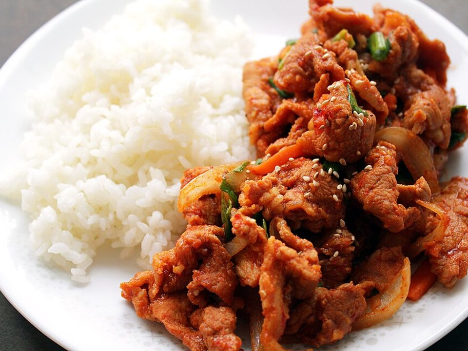

# Korean Beef Bulgogi Rice Bowls

Photo: Chloe Lim · CC BY 2.0 · [source](https://commons.wikimedia.org/wiki/File:Pork_bulgogi.jpg)

**Dinner** · Korean · 25 min · serves 4 · skill 2/3

> Caramelized, garlicky ground-beef bulgogi with cool cucumber, carrots, kimchi and a jammy fried egg on top. Mix it all together before eating.

| Per serving | kcal | Protein | Carbs | Fat | Fiber | Sodium | Cost |
| --- | --- | --- | --- | --- | --- | --- | --- |
| | 705 | 33 g | 67 g | 34 g | 4 g | 1500 mg | $3.23 |

Contains: beef, egg, gluten, sesame, spicy

## Ingredients

- 1 lb ground beef
- ¼ cup soy sauce
- 2 tbsp honey
- 4 garlic cloves, grated
- 4 green onions, sliced
- 1½ cups jasmine rice
- 1 cucumber, thinly sliced
- 2 carrots, cut in matchsticks
- 1 cup kimchi
- 4 eggs
- 1 tbsp sesame seeds

From the pantry: 1 tsp sesame oil, 1 tbsp neutral oil, rice vinegar, salt

## Steps

1. Cook the rice. Toss the cucumber and carrots with a splash of rice vinegar and a pinch of salt.
2. Brown the beef in a hot skillet, breaking it up, until crisp in spots, 6 to 7 minutes. Pour off excess fat.
3. Add the garlic and the white parts of the green onions for 30 seconds, then the soy sauce and honey. Simmer until glazy, 2 minutes. Stir in the sesame oil.
4. Fry the eggs in the oil until the whites are set and the edges lacy.
5. Build bowls: rice, beef, cucumbers, carrots, kimchi and an egg. Top with green onion tops and sesame seeds.

**Tip:** Kimchi is the one item Aldi often doesn't carry. Your bundle picks it up from another stop.

## Storing

Fridge 4 days · freezer up to 3 months. Store beef, rice and cold toppings separately. Fry a fresh egg when serving. Microwave covered, 1½ to 2 minutes, stirring halfway.

## Other ways to make it

- Ground turkey
- Ground pork
- Italian sausage
- Lentils (veg)
