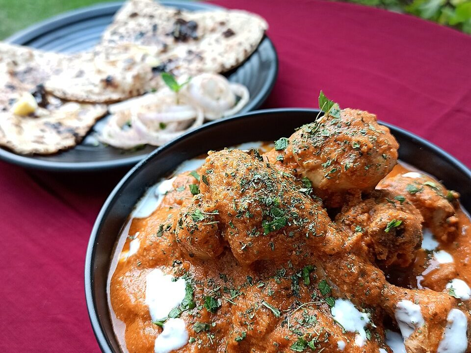

# Butter Chicken

Photo: Yuvraj Singh 97 · CC BY-SA 4.0 · [source](https://commons.wikimedia.org/wiki/File:Butter_Chicken_%26_Butter_Naan_-_Home_-_Chandigarh_-_India_-_0006.jpg)

**Dinner** · North Indian · 45 min · serves 4 · skill 2/3

> Yogurt-marinated chicken thighs charred under the broiler, then simmered in a silky, gently spiced tomato-butter-cream sauce. Better than most takeout.

| Per serving | kcal | Protein | Carbs | Fat | Fiber | Sodium | Cost |
| --- | --- | --- | --- | --- | --- | --- | --- |
| | 945 | 51 g | 92 g | 42 g | 7 g | 990 mg | $3.44 |

Contains: dairy, gluten

## Ingredients

- 1½ lb boneless chicken thighs, in bite-size pieces
- ½ cup plain Greek yogurt
- 1 tbsp garam masala, divided
- 2-inch piece ginger, grated
- 6 garlic cloves, grated
- 4 tbsp butter
- 1 onion, finely diced
- 14 oz crushed tomatoes (half a 28-oz can)
- 1 cup heavy cream
- 1½ cups basmati or jasmine rice
- naan, to serve
- cilantro

From the pantry: 2 tsp chili powder or paprika, 1 tsp cumin, 1 tsp sugar, salt

## Steps

1. Toss the chicken with the yogurt, half the garlic and ginger, 1 tsp garam masala, the chili powder and 1 tsp salt. Marinate 15 minutes or overnight.
2. Broil the chicken on a foil-lined sheet pan 8 to 10 minutes, until charred at the edges. It will finish in the sauce. Start the rice.
3. Melt 3 tbsp butter in a deep skillet. Cook the onion until soft and golden, 8 minutes. Add the remaining garlic, ginger, garam masala and the cumin for 1 minute.
4. Add the tomatoes and sugar and simmer 8 minutes until thick and darker red. Blend smooth if you like it restaurant-silky.
5. Stir in the cream and the chicken with its juices. Simmer 5 minutes, then finish with the last tbsp butter and salt to taste. Serve with rice, warm naan and cilantro.

**Tip:** Charring the chicken under the broiler gives the smoky, tandoor-like flavor that makes this taste like a restaurant made it.

## Storing

Fridge 4 days · freezer up to 3 months. Store curry and rice separately. Reheat on the stove over medium until simmering, or microwave 2 to 3 minutes, stirring once.

## Other ways to make it

- Steak
- Shrimp
- Pork
- Tofu
