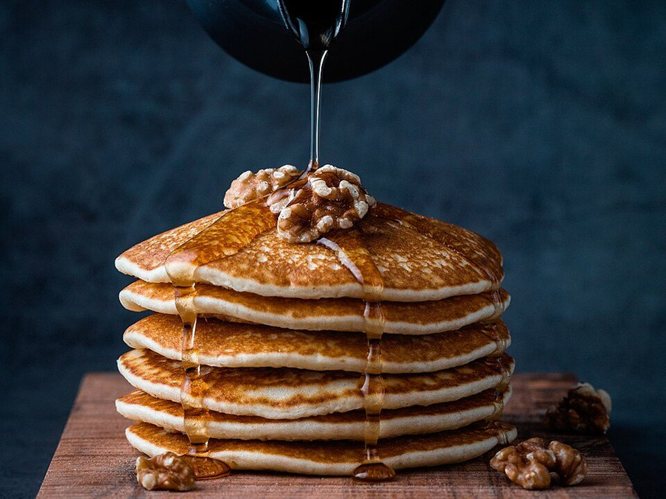

# Fluffy Buttermilk Pancakes

Photo: Mae Mu · CC0 · [source](https://commons.wikimedia.org/wiki/File:Foodiesfeed.com_pouring-honey-on-pancakes-with-walnuts.jpg)

**Breakfast** · American comfort · 25 min · serves 4 · skill 1/3

> Tall, tender diner-style pancakes with golden edges, stacked with butter, warm maple syrup and berries.

| Per serving | kcal | Protein | Carbs | Fat | Fiber | Sodium | Cost |
| --- | --- | --- | --- | --- | --- | --- | --- |
| | 405 | 10 g | 61 g | 14 g | 3 g | 450 mg | $1.21 |

Contains: dairy, gluten, egg

## Ingredients

- 1¾ cups milk plus 2 tbsp lemon juice (homemade buttermilk)
- 2 eggs
- 4 tbsp melted butter, plus more
- 1 lemon
- maple syrup
- berries

From the pantry: 2 cups flour, 2 tbsp sugar, 2 tsp baking powder, 1 tsp baking soda, ½ tsp salt, vanilla

## Steps

1. Stir the lemon juice into the milk and let it sit 5 minutes to thicken.
2. Whisk the flour, sugar, baking powder, soda and salt. In another bowl whisk the milk, eggs, melted butter and vanilla.
3. Fold the wet into the dry until just combined. Lumps are good. Rest 5 minutes.
4. Cook ⅓-cup scoops on a buttered griddle over medium until bubbles pop on top, 2 minutes. Flip and cook 1 minute more.
5. Serve stacked with butter, warm maple syrup and berries.

**Tip:** Don't press the pancakes after flipping. It knocks out the air that makes them fluffy.

## Storing

Fridge 4 days · freezer up to 2 months. Freeze in a single layer, then bag. Toast or microwave 45 seconds.

