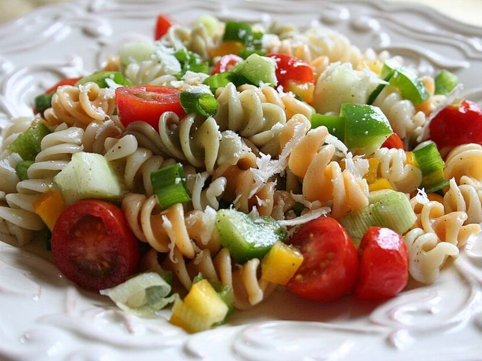

# Pesto Caprese Pasta Salad

Photo: Brynn · CC BY-SA 3.0 · [source](https://commons.wikimedia.org/wiki/File:Pasta_salad_closeup.JPG)

**Lunch** · Italian · 20 min · serves 6 · skill 1/3

> Penne tossed with basil pesto, fresh mozzarella pearls, sweet cherry tomatoes and spinach. Good cold, room temperature or warm.

| Per serving | kcal | Protein | Carbs | Fat | Fiber | Sodium | Cost |
| --- | --- | --- | --- | --- | --- | --- | --- |
| | 520 | 19 g | 60 g | 23 g | 4 g | 530 mg | $1.50 |

Contains: dairy, gluten, nuts

## Ingredients

- 1 lb penne
- ½ cup basil pesto
- 8 oz fresh mozzarella pearls
- 1 pint cherry tomatoes, halved
- 2 handfuls baby spinach
- ¼ cup grated Parmesan

From the pantry: 2 tbsp olive oil, 1 tbsp red wine vinegar, salt, pepper

## Steps

1. Cook the penne in well-salted water until al dente. Drain and rinse briefly under cold water.
2. Toss the warm pasta with the pesto, olive oil and vinegar.
3. Fold in the tomatoes, mozzarella and spinach.
4. Season with salt, pepper and the Parmesan.
5. Serve right away or chill up to 4 days.

**Tip:** Hold back a spoon of pesto and stir it in just before eating to refresh leftovers.

## Storing

Fridge 4 days · freezer not recommended. Stir in a spoon of pesto or olive oil to refresh. Eat cold or at room temperature. No reheating needed.

