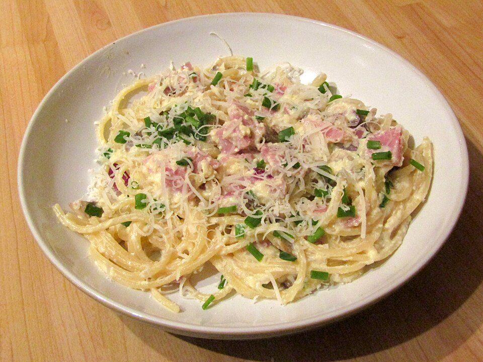

# Spaghetti Carbonara

Photo: Kolforn · CC BY-SA 4.0 · [source](https://commons.wikimedia.org/wiki/File:-2019-01-28_Spaghetti_carbonara,_Cromer.JPG)

**Dinner** · Italian · 20 min · serves 4 · skill 2/3

> The Roman classic: crisp bacon, a glossy sauce of egg yolks and Parmesan emulsified with starchy pasta water, and loads of cracked black pepper. No cream needed.

| Per serving | kcal | Protein | Carbs | Fat | Fiber | Sodium | Cost |
| --- | --- | --- | --- | --- | --- | --- | --- |
| | 775 | 41 g | 85 g | 29 g | 4 g | 1390 mg | $2.31 |

Contains: dairy, gluten, egg, pork

## Ingredients

- 1 lb spaghetti
- 12 oz thick-cut bacon (or pancetta), in strips
- 2 whole eggs plus 3 yolks
- 1¼ cups finely grated Parmesan
- 1 garlic clove, smashed

From the pantry: Lots of freshly ground black pepper, salt

## Steps

1. Whisk the eggs, yolks, Parmesan and 1½ tsp coarsely ground pepper into a thick paste.
2. Cook the bacon and garlic in a large skillet over medium until the bacon is crisp, 8 minutes. Discard the garlic and turn off the heat.
3. Boil the spaghetti in lightly salted water until al dente. Save 1½ cups of the pasta water.
4. Add the hot pasta to the bacon pan off the heat, toss, then add the egg mixture and ½ cup pasta water. Toss vigorously for 1 minute until creamy and glossy. Add more water as needed. The pan must be off the heat or the eggs will scramble.
5. Serve immediately with more Parmesan and pepper.

**Tip:** Grate the Parmesan on the finest holes you have. Coarse shreds won't melt into a smooth sauce.

## Storing

Fridge 1 days · freezer not recommended. Carbonara doesn't reheat well. Make only what you'll eat, or reheat gently with a splash of water over low heat.

