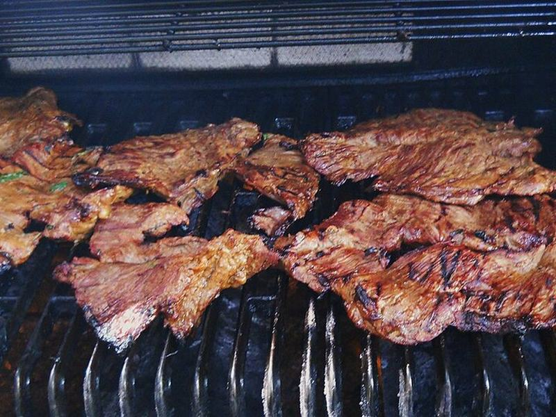

# Carne Asada Tacos

Photo: Daniel R. Blume from Toledo, Ohio, USA · CC BY-SA 2.0 · [source](https://commons.wikimedia.org/wiki/File:Carne_asada_(4472586086).jpg)

**Dinner** · Mexican · 30 min · serves 4 · skill 1/3

> Citrus-garlic marinated flank steak, charred hot and sliced thin, in warm corn tortillas with onion, cilantro, salsa and guac.

| Per serving | kcal | Protein | Carbs | Fat | Fiber | Sodium | Cost |
| --- | --- | --- | --- | --- | --- | --- | --- |
| | 740 | 44 g | 58 g | 40 g | 14 g | 840 mg | $4.64 |

Contains: beef

## Ingredients

- 1½ lb flank or skirt steak
- 1 orange
- 4 limes
- 4 garlic cloves
- 1 jalapeño
- 1 bunch cilantro
- 16 corn tortillas
- 1 white onion
- salsa
- 2 avocados

From the pantry: ¼ cup oil, 2 tsp cumin, 1 tbsp soy sauce, salt

## Steps

1. Blend the orange and juice of 2 limes, garlic, jalapeño, half the cilantro, oil, cumin, soy and 1 tsp salt. Marinate the steak 30 minutes to 8 hours.
2. Grill or sear in a screaming-hot cast-iron pan 4 to 5 minutes per side for medium.
3. Rest 10 minutes, then slice thin across the grain.
4. Char the tortillas and mash the avocados with lime and salt.
5. Fill tortillas with steak, chopped onion, cilantro, salsa and guac.

**Tip:** Don't marinate longer than 8 hours. The citrus turns the steak mushy.

## Storing

Fridge 4 days · freezer up to 3 months. Reheat sliced steak briefly in a hot skillet.

## Other ways to make it

- Chicken
- Shrimp
- Pork
- Tofu
