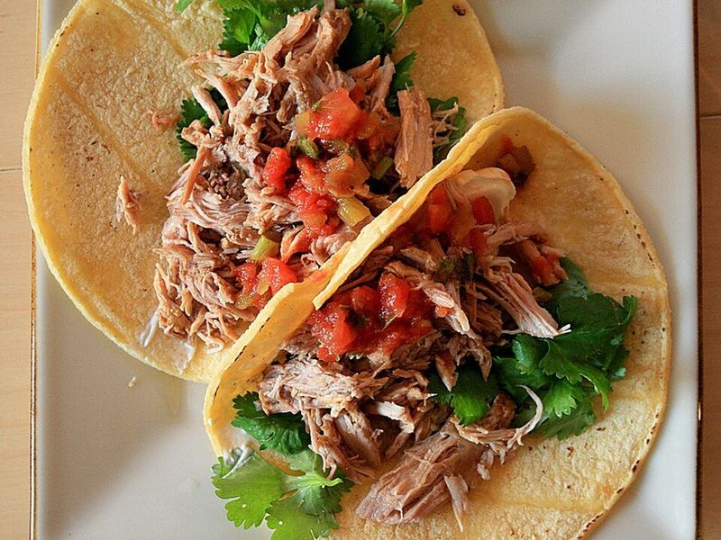

# Crispy Carnitas Burrito Bowls

Photo: Mike McCune · CC BY 2.0 · [source](https://commons.wikimedia.org/wiki/File:Carnitas.jpg)

**Dinner** · Mexican & Tex-Mex · 200 min · serves 6 · skill 2/3

> Pork shoulder slow-roasted with orange and lime until meltingly tender, then crisped under the broiler and piled over cilantro-lime rice with beans, corn, salsa and guac.

| Per serving | kcal | Protein | Carbs | Fat | Fiber | Sodium | Cost |
| --- | --- | --- | --- | --- | --- | --- | --- |
| | 1160 | 56 g | 98 g | 62 g | 18 g | 1240 mg | $3.50 |

Contains: dairy

## Ingredients

- 3 lb boneless pork shoulder, in 2-inch chunks
- 2 oranges
- 4 limes
- 6 garlic cloves, smashed
- 1 onion, quartered
- 2 cups rice
- 1 bunch cilantro
- 2 cans black beans
- 1½ cups corn
- 16 oz salsa
- 3 avocados
- 1 cup sour cream

From the pantry: 2 tsp cumin, 2 tsp dried oregano, 1 tbsp salt, 2 bay leaves

## Steps

1. Heat the oven to 325°F. Toss the pork with the salt, cumin and oregano in a Dutch oven. Squeeze in the oranges and 2 limes, then add the squeezed halves, garlic, onion and bay leaves.
2. Cover and roast 2½ to 3 hours, until the pork falls apart. Shred it right in its juices and fat.
3. Spread the pork on a sheet pan with a ladle of the juices and broil 5 to 8 minutes, until the edges are browned and crispy.
4. Meanwhile cook the rice and stir in chopped cilantro and the juice of 1 lime. Warm the beans and corn. Mash the avocados with lime and salt.
5. Build bowls: rice, beans, corn, carnitas, salsa, guacamole and sour cream.

**Tip:** Leftover carnitas crisp up perfectly in a hot skillet. Use them for tacos or breakfast hash later in the week.

## Storing

Fridge 4 days · freezer up to 3 months. Store pork with some juices. Crisp it in a hot skillet. Keep guac and toppings separate.

