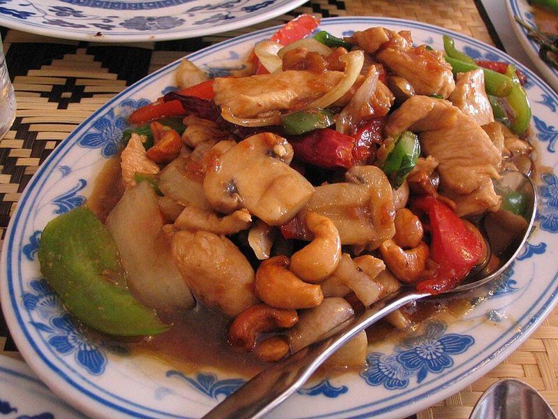

# Cashew Chicken Stir-Fry with Peppers

Photo: Simon Law from Montréal, QC, Canada · CC BY-SA 2.0 · [source](https://commons.wikimedia.org/wiki/File:Cashewchickenphoto.jpg)

**Dinner** · Chinese & Cantonese · 30 min · serves 4 · skill 1/3

> Tender velveted chicken and crunchy toasted cashews tossed with sweet peppers in a glossy oyster-hoisin sauce. Faster than takeout and a lot fresher.

| Per serving | kcal | Protein | Carbs | Fat | Fiber | Sodium | Cost |
| --- | --- | --- | --- | --- | --- | --- | --- |
| | 800 | 50 g | 84 g | 29 g | 5 g | 1220 mg | $2.97 |

Contains: gluten, nuts, sesame, shellfish

## Ingredients

- 1½ lb chicken breasts, in ¾-inch pieces
- ¾ cup roasted unsalted cashews
- 2 bell peppers, in 1-inch squares
- 1 onion, in 1-inch pieces
- 4 green onions, in 1-inch lengths
- 4 garlic cloves, minced
- 1 tbsp grated ginger
- ¼ cup soy sauce, divided
- 2 tbsp oyster sauce
- 1 tbsp hoisin
- 1½ cups jasmine rice

From the pantry: 2 tbsp cornstarch, 3 tbsp oil, 1 tbsp rice vinegar, 1 tsp sugar, 1 tsp sesame oil

## Steps

1. Start the rice. Toss the chicken with 1 tbsp soy sauce and 1 tbsp cornstarch and let it sit while you prep. Whisk the remaining soy, oyster sauce, hoisin, vinegar, sugar, sesame oil, 1 tbsp cornstarch and ⅓ cup water for the sauce.
2. Toast the cashews in a dry wok or large skillet over medium heat, stirring, until golden in spots, 3 to 4 minutes. Tip them onto a plate.
3. Heat 2 tbsp oil over high heat until shimmering. Spread the chicken in one layer and leave it 2 minutes to brown, then stir-fry until no pink remains and it reaches 165°F inside, 3 to 4 minutes more. Move to the plate.
4. Add the remaining oil, the onion and peppers and stir-fry until crisp-tender and charred at the edges, 2 to 3 minutes. Add the garlic, ginger and green onions for 30 seconds.
5. Stir the sauce, pour it in and bubble until thick and glossy, about 1 minute. Return the chicken and cashews, toss to coat and serve over rice.

**Tip:** Add the cashews at the very end so they stay crunchy. If they sit in the sauce they go soft.

## Storing

Fridge 3 days · freezer up to 2 months. Reheat in a skillet with a splash of water, or microwave 2 minutes. The cashews soften a bit but still taste good.

## Other ways to make it

- Steak
- Shrimp
- Pork
- Tofu
