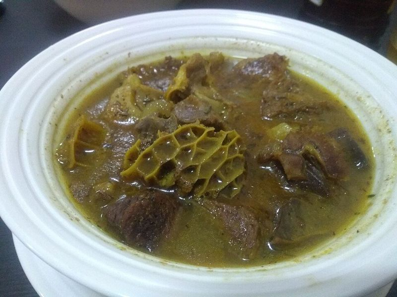

# Nigerian Catfish Pepper Soup with Boiled Plantain

Photo: bob walker · CC BY-SA 2.0 · [source](https://commons.wikimedia.org/wiki/File:Assorted_meat_pepper_soup_at_Lagos_Island.jpg)

**Lunch** · Nigerian & West African · 40 min · serves 4 · skill 2/3

> Nigeria's famous 'point and kill': chunks of catfish in a hot, aromatic, brothy soup that clears the sinuses, with boiled plantain and potatoes to soak it up.

| Per serving | kcal | Protein | Carbs | Fat | Fiber | Sodium | Cost |
| --- | --- | --- | --- | --- | --- | --- | --- |
| | 505 | 40 g | 57 g | 14 g | 6 g | 540 mg | $3.87 |

Contains: fish, spicy

## Ingredients

- 2 lb catfish fillets, in 2-inch chunks
- 1 onion, chopped
- 2 jalapeños (or 1 Scotch bonnet), minced
- 1-inch piece ginger, grated
- 2 garlic cloves, grated
- 2 just-ripe plantains, peeled and cut in thirds
- 1 lb baby potatoes, halved
- 1 small pack fresh basil
- 1 lime

From the pantry: 2 tbsp pepper soup spice (or 1 tsp each ground coriander, fennel seed and black pepper with ½ tsp nutmeg), 1 tsp cayenne, 2 chicken bouillon cubes, 1 tsp dried thyme, salt

## Steps

1. Rub the catfish with the juice of the lime and a pinch of salt, rinse, and pat dry.
2. Bring 6 cups water to a boil with the onion, ginger, garlic, bouillon and thyme. Add the plantains and potatoes and cook at a lively simmer for 12 minutes.
3. Stir in the pepper soup spice, cayenne and jalapeños and simmer 5 minutes so the raw spice taste cooks off.
4. Slide in the catfish, lower the heat and simmer gently without stirring until the fish flakes, 8 to 10 minutes. Stirring breaks it up, so just swirl the pot.
5. Tear in the basil, simmer 30 seconds, taste for salt and serve steaming in deep bowls with the plantain and potatoes.

**Tip:** Nigerian cooks use scent leaf (efirin) and a spice mix of calabash nutmeg and alligator pepper; African markets sell ready-made pepper soup spice, and basil is the closest supermarket stand-in for scent leaf.

Adapted from [Nigerian Food TV](https://www.nigerianfoodtv.com/catfish-pepper-soup/).

## Storing

Fridge 2 days · freezer not recommended. Reheat gently on the stove just until hot so the fish holds together.

