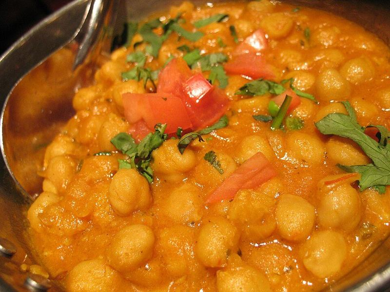

# Chana Masala

Photo: Simon Law (sfllaw) from Montréal, QC, Canada · CC BY-SA 2.0 · [source](https://commons.wikimedia.org/wiki/File:Chana_masala.jpg)

**Dinner** · Indian · 35 min · serves 4 · skill 1/3

> Punjabi-style chickpeas in a deeply browned onion, ginger and tomato gravy with warm spices and a squeeze of lemon. Vegan, pantry-friendly and deeply savory.

| Per serving | kcal | Protein | Carbs | Fat | Fiber | Sodium | Cost |
| --- | --- | --- | --- | --- | --- | --- | --- |
| | 580 | 17 g | 99 g | 15 g | 14 g | 850 mg | $1.67 |

Contains: none of the tracked allergens

## Ingredients

- 2 cans chickpeas, drained
- 2 onions, finely diced
- 5 garlic cloves, grated
- 2-inch piece ginger, grated
- 1 jalapeño, minced
- 14 oz crushed tomatoes
- 2 tsp garam masala
- 1 lemon
- cilantro
- 1½ cups basmati or jasmine rice

From the pantry: 3 tbsp oil, 2 tsp cumin, 1 tsp coriander, ½ tsp turmeric, salt

## Steps

1. Start the rice. Heat the oil over medium and cook the onions with a pinch of salt, stirring, until deep golden brown, 12 to 15 minutes. Don't rush this. It's where the flavor comes from.
2. Add the garlic, ginger and jalapeño for 1 minute, then the cumin, coriander, turmeric and garam masala for 30 seconds.
3. Add the tomatoes and cook until the oil starts to separate at the edges, 5 minutes.
4. Add the chickpeas and 1 cup water. Simmer 10 minutes, mashing a handful of chickpeas to thicken the gravy.
5. Season with salt and lemon juice. Serve over rice with lots of cilantro.

**Tip:** A splash of the chickpea can liquid makes the gravy extra creamy.

## Storing

Fridge 5 days · freezer up to 3 months. Store curry and rice separately. Reheat on the stove over medium until simmering, or microwave 2 to 3 minutes, stirring once.

