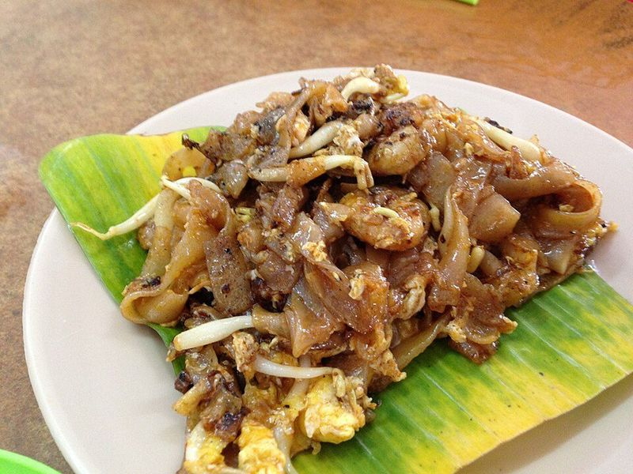

# Char Kway Teow (Smoky Fried Rice Noodles with Shrimp)

Photo: brown_colour · CC BY 2.0 · [source](https://commons.wikimedia.org/wiki/File:Char_kway_teow_in_parit_buntar.jpg)

**Dinner** · Malaysian & Singaporean · 35 min · serves 4 · skill 2/3

> Penang's famous hawker noodle: wide rice noodles seared in a ripping-hot wok with shrimp, egg, bean sprouts and green onions in a dark, sweet-salty soy sauce, with that smoky charred edge.

| Per serving | kcal | Protein | Carbs | Fat | Fiber | Sodium | Cost |
| --- | --- | --- | --- | --- | --- | --- | --- |
| | 765 | 39 g | 105 g | 20 g | 3 g | 1610 mg | $3.58 |

Contains: gluten, egg, shellfish, spicy

## Ingredients

- 16 oz wide rice stick noodles
- 1 lb shrimp, peeled
- 4 eggs, beaten
- 8 oz bean sprouts
- 4 green onions, in 2-inch pieces
- 4 garlic cloves, minced
- 4 tbsp soy sauce
- 2 tbsp oyster sauce
- 2 tbsp kecap manis
- 1 tbsp sambal oelek

From the pantry: 4 tbsp oil, 1 tsp sugar

## Steps

1. Soak the noodles in hot tap water until pliable but still firm, 20 to 30 minutes (or per package), then drain well. Stir the soy sauce, oyster sauce, kecap manis, sambal and sugar together.
2. Work in two batches so the wok stays hot. Heat 2 tbsp oil in a wok or large skillet over high until smoking. Add half the shrimp and cook 1 minute, then half the garlic for 10 seconds.
3. Add half the noodles and half the sauce and toss gently, letting them sit 20 to 30 seconds between tosses so they char in spots, 2 to 3 minutes.
4. Push everything aside, pour half the eggs into the empty space, let set for 30 seconds, then scramble and fold through the noodles.
5. Add half the bean sprouts and green onions and toss for 30 seconds. Serve, then repeat with the second batch.

**Tip:** Chinese sweet sausage (lap cheong) and garlic chives are classic; add a sliced link per batch with the shrimp if you can get one. Dark soy sauce instead of half the regular soy gives the authentic deep color.

Adapted from [RecipeTin Eats](https://www.recipetineats.com/char-kway-teow/).

## Storing

Fridge 2 days · freezer not recommended. Best fresh. Reheat in a hot skillet with a splash of water rather than the microwave.

