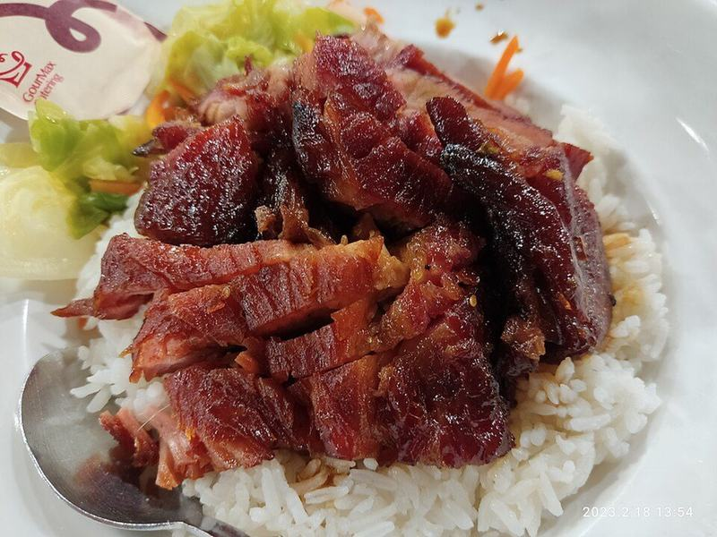

# Oven Char Siu Pork with Rice & Garlicky Bok Choy

Photo: Honahjs LWUEIMAHAG · CC BY-SA 4.0 · [source](https://commons.wikimedia.org/wiki/File:HKU_%E9%A6%99%E6%B8%AF%E5%A4%A7%E5%AD%B8_Pok_Fu_Lam_Road_campus_%E8%8E%8A%E6%9C%88%E6%98%8E%E6%96%87%E5%A8%9B%E4%B8%AD%E5%BF%83_Chong_Yuet_Ming_Building_%E9%A4%90%E5%BB%B3_Canteen_%E5%8D%88%E9%A4%90_Lunch_%E7%87%92%E5%91%B3_siu_mei_%E5%8F%89%E7%87%92%E9%A3%AF_Char_Siu_Rice_February_2023_Px3_02.jpg)

**Dinner** · Chinese · 75 min · serves 5 · skill 2/3

> Cantonese barbecue pork at home: strips of pork shoulder lacquered in a sticky hoisin-honey glaze and roasted until the edges char. Sliced over rice with garlicky bok choy.

| Per serving | kcal | Protein | Carbs | Fat | Fiber | Sodium | Cost |
| --- | --- | --- | --- | --- | --- | --- | --- |
| | 820 | 38 g | 69 g | 43 g | 2 g | 1170 mg | $2.41 |

Contains: gluten, sesame

## Ingredients

- 2 lb boneless pork shoulder, cut in 2-inch-thick strips
- ⅓ cup hoisin sauce
- ¼ cup honey, plus 2 tbsp for glazing
- 3 tbsp soy sauce
- 6 garlic cloves, grated
- 1-inch ginger, grated
- 2 cups jasmine rice
- 1 lb baby bok choy, halved
- green onions, sliced

From the pantry: 1 tsp five-spice powder, 1 tbsp sesame oil, 2 tbsp oil, 1 tbsp brown sugar, salt

## Steps

1. Whisk the hoisin, ¼ cup honey, soy sauce, brown sugar, five-spice, sesame oil, half the garlic and the ginger. Set aside ¼ cup of it for basting. Coat the pork strips in the rest and marinate at least 30 minutes, or overnight in the fridge.
2. Heat the oven to 425°F. Line a sheet pan with foil, set a rack on it and pour 1 cup water into the pan so the drippings don't burn. Lay the pork on the rack.
3. Roast 25 minutes. Flip, brush with the reserved marinade and roast 15 to 20 minutes more, until the edges char and the center reaches 145°F. Meanwhile, cook the rice.
4. Mix the last 2 tbsp honey with 1 tbsp hot water and brush it over the pork. Broil 2 to 3 minutes, watching closely, until glossy and caramelized. Rest 10 minutes.
5. Stir-fry the bok choy in the oil over high heat with the rest of the garlic and a pinch of salt, 3 to 4 minutes, until the stems are crisp-tender.
6. Slice the pork thinly and serve over rice with the bok choy and green onions. Spoon over any pan juices.

**Tip:** Pork shoulder stays juicy even if you roast it a little long. A thick slice of tenderloin works too, but pull it at 145°F.

## Storing

Fridge 4 days · freezer up to 3 months. Store the sliced pork separately from the rice. Reheat in a covered skillet with a splash of water, or eat it cold in fried rice.

