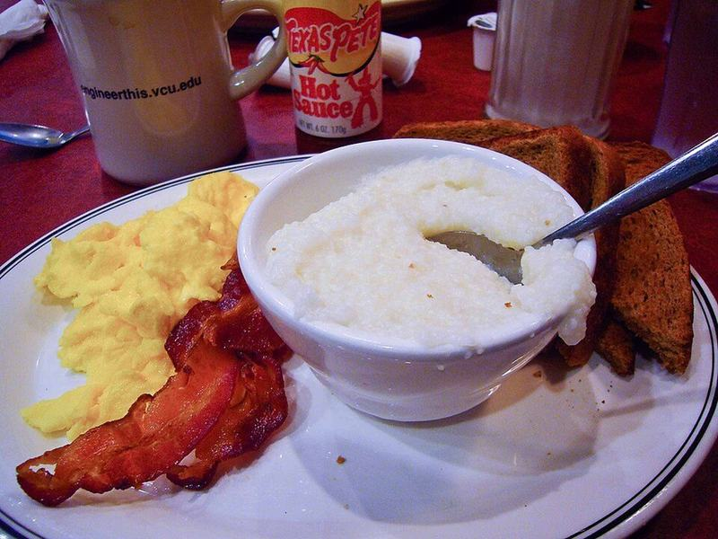

# Cheddar Grits Bowls with Fried Eggs & Turkey Bacon

Photo: sashafatcat · CC BY 2.0 · [source](https://commons.wikimedia.org/wiki/File:Grits1.jpg)

**Breakfast** · Southern & soul food · 25 min · serves 4 · skill 1/3

> Creamy, buttery sharp-cheddar grits topped with crispy-edged fried eggs, crumbled turkey bacon, green onions and a shake of hot sauce.

| Per serving | kcal | Protein | Carbs | Fat | Fiber | Sodium | Cost |
| --- | --- | --- | --- | --- | --- | --- | --- |
| | 630 | 33 g | 40 g | 38 g | 2 g | 1150 mg | $1.66 |

Contains: dairy, egg

## Ingredients

- 1 cup quick grits
- 2 cups milk
- 1 cup shredded sharp cheddar
- 2 tbsp butter
- 8 eggs
- 8 slices turkey bacon
- 2 green onions, sliced

From the pantry: 1 tbsp oil, 1 tsp hot sauce, salt, pepper

## Steps

1. Bring the milk, 2 cups water and ¾ tsp salt to a simmer in a saucepan over medium. Whisk in the grits slowly and cook, whisking often, until thick and creamy, 5 to 7 minutes.
2. Off the heat, stir in the cheddar, butter and plenty of black pepper. Cover to keep warm; loosen with a splash of water if it stiffens.
3. Cook the turkey bacon in a large skillet over medium until browned and crisp, 3 to 4 minutes per side. Drain on a towel and chop.
4. Add the oil to the skillet and fry the eggs over medium until the whites are set and lacy at the edges and the yolks still runny, 3 minutes.
5. Spoon the grits into bowls, top each with two eggs, the turkey bacon, green onions and hot sauce.

**Tip:** Whisk the grits into simmering, not boiling, liquid and add them in a slow stream. That's what keeps them lump-free.

## Storing

Fridge 3 days · freezer not recommended. Grits set firm in the fridge. Reheat with a splash of milk over low, whisking, until creamy again.

