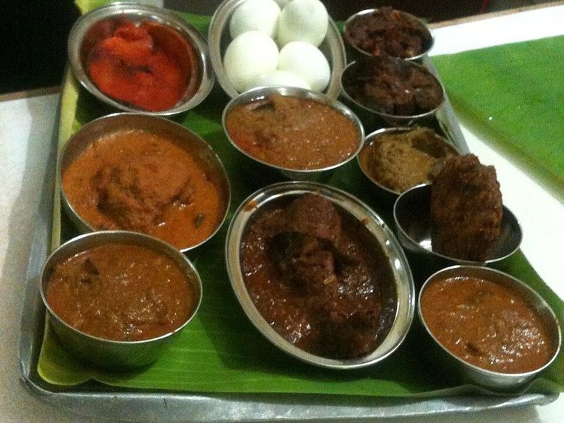

# Chettinad Chicken Curry with Roasted Spices

Photo: Ask27 · CC BY-SA 3.0 · [source](https://commons.wikimedia.org/wiki/File:Anandas_Chettinad_Hotel,_sample_tray_in_Coimbatore.JPG)

**Dinner** · South Indian & Goan · 60 min · serves 4 · skill 2/3

> Tamil Nadu's boldest curry: chicken simmered in a dark masala of freshly roasted coriander, black pepper, fennel, star anise and coconut. Fiery, fragrant and deeply savory.

| Per serving | kcal | Protein | Carbs | Fat | Fiber | Sodium | Cost |
| --- | --- | --- | --- | --- | --- | --- | --- |
| | 730 | 52 g | 75 g | 24 g | 4 g | 530 mg | $2.80 |

Contains: spicy

## Ingredients

- 2 lb boneless chicken thighs, in 1½-inch pieces
- ¼ cup unsweetened shredded coconut
- 2 large onions, thinly sliced
- 2 to 3 Roma tomatoes, diced
- 1 tbsp grated ginger
- 4 garlic cloves, grated
- 1 lemon
- chopped cilantro
- 1½ cups basmati rice

From the pantry: 3 tbsp oil (sesame/gingelly oil is traditional), 3 tbsp coriander seeds, 2 tsp black peppercorns, 1 tsp fennel seeds, 1 tsp cumin seeds, 5 dried red chilies, 4 cloves, 4 green cardamom pods, 1 star anise, 1 small cinnamon stick, 1 tsp turmeric, 1½ tsp salt

## Steps

1. Toss the chicken with the turmeric, ½ tsp salt and the juice of the lemon. Set aside 15 minutes while you make the masala.
2. Dry-roast the coriander, peppercorns, fennel, cumin, chilies, cloves, cardamom, star anise and cinnamon in a skillet over medium-low, stirring, until a shade darker and very fragrant, 3 to 4 minutes. Add the coconut and toast until light golden, 1 to 2 minutes. Cool, then blend with ½ cup water into a smooth paste. Start the rice.
3. Heat the oil in a heavy pot over medium. Cook the onions until soft and golden, 8 to 10 minutes, then the ginger and garlic for 1 minute.
4. Add the chicken and tomatoes with the remaining salt. Cook, stirring, until the tomatoes soften and the chicken is opaque, 6 to 8 minutes.
5. Stir in the masala paste and 1 cup water, cover and simmer on low until the chicken is tender and the gravy is thick, 15 to 20 minutes. Add cilantro and serve with rice.

**Tip:** Grind the masala as smoothly as you can: it makes the gravy silky. Curry leaves fried with the onions and a pinch of kalpasi (black stone flower) from an Indian grocer are the traditional Chettinad touches.

Adapted from [Yummy Tummy Aarthi](https://www.yummytummyaarthi.com/wprm_print/chicken-chettinad-chettinad-chicken-recipe).

## Storing

Fridge 4 days · freezer up to 3 months. Reheat covered on the stove with a splash of water.

