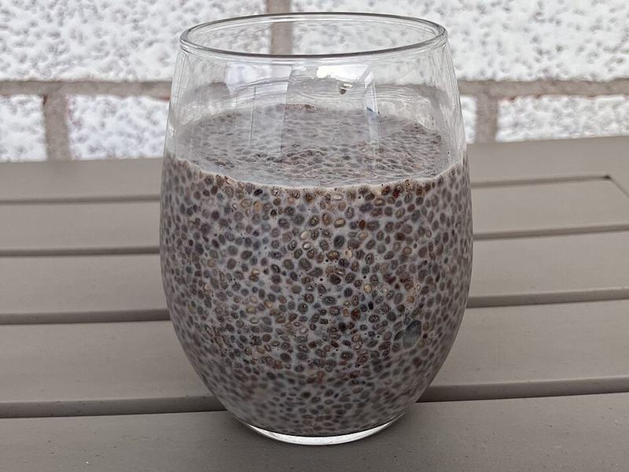

# Coconut Chia Pudding with Berries

Photo: Gogerr · CC BY-SA 4.0 · [source](https://commons.wikimedia.org/wiki/File:Chia_Pudding.jpg)

**Breakfast** · American comfort · 5 min · serves 4 · skill 1/3

> Make-ahead jars of creamy coconut chia pudding layered with jammy berries. Five minutes tonight, breakfast for four days.

| Per serving | kcal | Protein | Carbs | Fat | Fiber | Sodium | Cost |
| --- | --- | --- | --- | --- | --- | --- | --- |
| | 385 | 8 g | 31 g | 28 g | 8 g | 350 mg | $1.28 |

Contains: none of the tracked allergens

## Ingredients

- ½ cup chia seeds
- 1 can coconut milk
- 1 cup milk (or more coconut milk)
- 3 tbsp honey or maple
- 2 cups berries

From the pantry: 1 tsp vanilla, pinch of salt

## Steps

1. Whisk the coconut milk, milk, honey, vanilla and salt.
2. Whisk in the chia seeds. Wait 5 minutes and whisk again to break up clumps.
3. Divide among 4 jars.
4. Top with berries and seal.
5. Refrigerate at least 4 hours or overnight until thick.

**Tip:** Whisking twice is the trick to pudding that sets evenly with no clumps.

## Storing

Fridge 5 days · freezer not recommended. Eat cold. Stir before eating.

