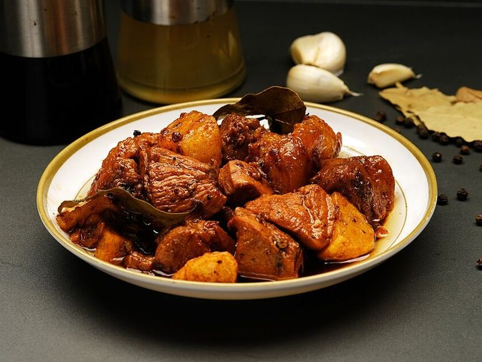

# Filipino Chicken Adobo with Garlic & Bay

Photo: Joy D. Ganaden · CC BY-SA 4.0 · [source](https://commons.wikimedia.org/wiki/File:Adobo_DSCF4391.jpg)

**Dinner** · Filipino · 60 min · serves 4 · skill 1/3

> The Philippines' national dish: chicken thighs braised in soy, vinegar, a whole head's worth of garlic and bay leaves until the sauce turns glossy, tangy and deeply savory. Spoon it over plenty of rice.

| Per serving | kcal | Protein | Carbs | Fat | Fiber | Sodium | Cost |
| --- | --- | --- | --- | --- | --- | --- | --- |
| | 775 | 64 g | 81 g | 19 g | 1 g | 1390 mg | $2.99 |

Contains: gluten

## Ingredients

- 2½ lb boneless skinless chicken thighs, halved
- ⅓ cup soy sauce
- 10 garlic cloves, crushed
- 2 cups jasmine rice
- 2 green onions, sliced

From the pantry: ⅓ cup white or cane vinegar, 2 tbsp oil, 1 tbsp brown sugar, 1 tsp whole black peppercorns, 3 dried bay leaves, salt

## Steps

1. Toss the chicken with the soy sauce and crushed garlic in a bowl and let it sit for 20 to 30 minutes (or up to overnight in the fridge). Start the rice.
2. Lift the chicken out of the marinade, fish out the garlic and keep both. Heat the oil in a wide heavy pot over medium-high and brown the chicken in two batches, about 2 minutes per side. Set aside.
3. Lower the heat to medium, fry the reserved garlic until just golden, 1 minute, then return the chicken with the marinade, peppercorns, bay leaves and 1 cup water. Bring to a boil, cover and simmer for 25 minutes.
4. Pour in the vinegar and let it boil for a minute without stirring so its sharp edge cooks off. Then stir, uncover and simmer until the sauce reduces by about half and coats the chicken, 12 to 15 minutes.
5. Stir in the brown sugar, taste for salt, and serve over rice with green onions and lots of the sauce.

**Tip:** Not stirring right after the vinegar goes in is the classic Filipino trick: it keeps the sauce tangy without tasting raw. For a crisp finish, pull the cooked chicken out and sear it in a hot pan for 2 minutes before returning it to the sauce.

Adapted from [Panlasang Pinoy](https://panlasangpinoy.com/filipino-chicken-adobo-recipe/).

## Storing

Fridge 5 days · freezer up to 3 months. Adobo improves overnight. Reheat covered in a saucepan over medium-low, or microwave 2 minutes.

