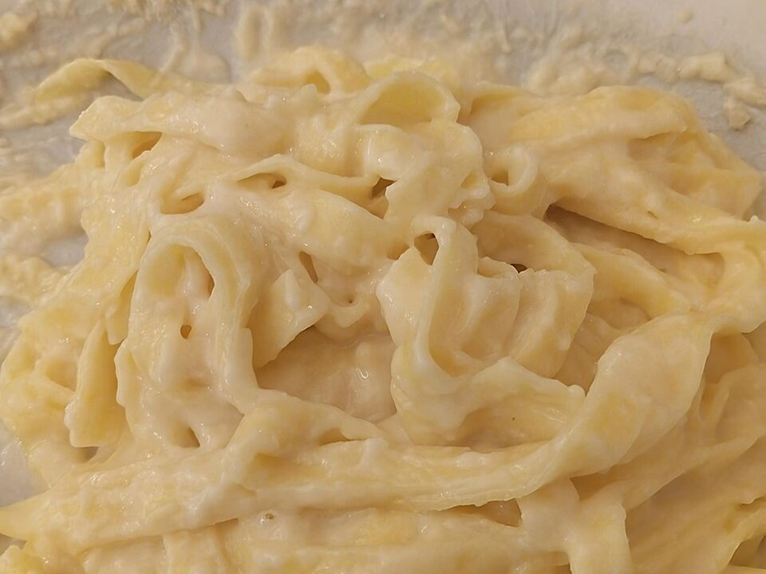

# Chicken & Broccoli Fettuccine Alfredo

Photo: Civa61 · CC BY 4.0 · [source](https://commons.wikimedia.org/wiki/File:Fettuccine_Alfredo_originals.jpg)

**Dinner** · Italian · 30 min · serves 4 · skill 1/3

> A real Alfredo made with butter, cream and Parmesan, not a jar. Seared chicken and tender broccoli make it a full meal.

| Per serving | kcal | Protein | Carbs | Fat | Fiber | Sodium | Cost |
| --- | --- | --- | --- | --- | --- | --- | --- |
| | 1120 | 54 g | 95 g | 58 g | 7 g | 920 mg | $2.94 |

Contains: dairy, gluten

## Ingredients

- 1 lb chicken breasts
- 1 lb fettuccine or spaghetti
- 1 lb broccoli florets
- 4 tbsp butter
- 3 garlic cloves, minced
- 1½ cups heavy cream
- 1¼ cups grated Parmesan
- parsley

From the pantry: 1 tbsp olive oil, nutmeg, salt, pepper

## Steps

1. Season and sear the chicken in the oil until cooked through, 5 to 6 minutes per side. Rest, then slice.
2. Boil the pasta, adding the broccoli for the last 3 minutes. Save 1 cup pasta water and drain.
3. Melt the butter in the empty pot with the garlic for 1 minute. Add the cream and simmer 3 minutes.
4. Off the heat, whisk in the Parmesan a handful at a time with a pinch of nutmeg.
5. Toss in the pasta and broccoli, loosening with pasta water. Top with the chicken, pepper and parsley.

**Tip:** Alfredo thickens fast as it cools. Keep some pasta water nearby to loosen it at the table.

## Storing

Fridge 3 days · freezer not recommended. Alfredo thickens. Reheat on low with a splash of milk, stirring constantly.

## Other ways to make it

- Steak
- Shrimp
- Pork
- Tofu
